MySQL 与 MongoDB 日志读写性能对比

温子健

摘　要：本文基于统一日志模型和REST接口，比较Spring Data JPA/MySQL与Spring Data MongoDB/MongoDB的日志读写性能。实验使用四台云主机分两轮部署，预置10万条日志，在1至200线程下测试查询与单条写入，每档重复3次。200线程时，两库查询吞吐量分别为1,258.0、1,167.8次/秒，写入吞吐量分别为4,608.5、4,236.2次/秒。72次正式测量共记录20,730,914次请求、0次错误。结合响应时间分布与资源监测，分析增加并发的吞吐收益和延迟变化。

关键词：MySQL；MongoDB；Spring Data JPA；JMeter；Prometheus

Log Read and Write Performance of MySQL and MongoDB

WEN Zi-Jian

Abstract: This experiment compares Spring Data JPA/MySQL and Spring Data MongoDB/MongoDB using a shared log model and REST API. Four cloud servers are reused in two sequential rounds. Each database starts with 100,000 records. Read and write workloads use 1 to 200 concurrent threads, with three repetitions per level. JMeter measures latency, throughput and errors, while Prometheus collects resource metrics every five seconds. At 200 threads, read throughput is 1258.0 requests/s for MySQL and 1167.8 requests/s for MongoDB; write throughput is 4608.5 and 4236.2 requests/s, respectively. The analysis relates latency distributions to application, database and load-generator resource usage.

Key words: MySQL; MongoDB; Spring Data JPA; JMeter; Prometheus

# 1　问题描述

日志服务需要持续写入事件，并按日志级别和时间范围查询历史记录。本文比较关系型表与文档集合在同一Java日志业务中的读写表现，重点考察并发增加时吞吐量、响应时间分布及资源占用的变化。两条链路使用相同接口、字段、请求生成规则和JMeter断言，使对照结果对应实际应用访问过程。

# 2　实验环境与方法

## 2.1　四机两轮部署

实验采用四台Ubuntu 18.04主机。第一轮运行MySQL和JPA应用，第二轮停止MySQL并切换为MongoDB及对应应用。两轮复用相同的数据库机、应用机、内网路径和资源配置，Compiler的编译工作在压测开始前完成。

表1　服务器配置与分工

| 主机 | CPU与可见内存 | 实验角色 |
| --- | --- | --- |
| Compiler | 2核，792 MiB | Java 17编译与JMeter压测 |
| Node1 | 2核，1800 MiB | MySQL或MongoDB，分轮运行 |
| Node2 | 2核，792 MiB | 当前被测Spring应用 |
| Manager | 2核，1800 MiB | Prometheus监控 |

表2　软件与运行参数

| 项目 | 实际配置 |
| --- | --- |
| 应用 | Spring Boot 3.3.13，Java 17.0.21，堆256 MiB |
| 编译与压测 | Java 17.0.7，Maven 3.9.16，JMeter 5.6.3 |
| MySQL | 8.4.13，InnoDB缓冲池256 MiB |
| MongoDB | 7.0.16，WiredTiger缓存0.25 GiB |
| 数据库资源 | 两轮数据库容器内存上限均为1 GiB |
| 连接池 | 两条链路最大20个连接，最小5个 |
| 监控 | Prometheus 3.7.3，node_exporter 1.10.2，5秒采样 |

## 2.2　日志模型与统一接口

日志字段包括id、traceId、level、source、message、clientIp和createdAt。id采用26位ULID，createdAt统一保存UTC毫秒时间，message最长4096字符。MySQL以CHAR(26)保存主键、DATETIME(6)保存时间；MongoDB将id映射为字符串_id，以BSON Date保存时间。

POST /api/logs执行单条写入并返回HTTP 201及保存的对象。GET /api/logs接收level、from、to、page、size，按左闭右开时间范围查询，返回content、page、size、totalElements和totalPages。两套实现均按createdAt和id降序排列，并建立级别、时间、主键联合索引。

JPA实现使用EntityManager.persist写入、JpaRepository条件分页查询；MongoDB实现使用Spring Data MongoTemplate执行insert、count和find。两条读取链路均返回当前页与匹配总数。MongoTemplate默认写入_class类型元数据，HTTP业务字段保持统一。MySQL每次事务提交刷盘并关闭二进制日志，MongoDB采用单机WiredTiger及w=1、journal=true写入确认。

# 3　实验设计

## 3.1　基准数据与请求

生成器以20261111为随机种子创建10万条日志，时间均匀覆盖2026年11月1日UTC全天，包含五种级别和八个服务来源。两库导入同一批业务字段，导入后核对记录数。固定查询为INFO级别、UTC 06:00至07:00、第一页20条，匹配总数为2497条。写入请求使用250字符正文和固定业务时间，服务端生成ULID。

## 3.2　升压与重复测量

查询与写入分别采用1、10、25、50、100、200线程，每档重复3次，两种数据库共72次正式测量。每次运行前恢复10万条基准数据，随后记录10秒升压、30秒预热和120秒正式测量。正式窗口按请求开始时间截取；窗口结束附近的收尾请求单独保留，原始HTTP采样行可完整复核。预热写入计入本次数据库增长，下一次运行前恢复基准。写入测试将全程成功请求数与数据库记录增长量核对，查询测试核对记录总数保持不变。

## 3.3　指标与监控

JMeter使用非GUI模式，保存完整HTTP响应时间及成功状态，不扣除网络连接耗时。统计每次运行的吞吐量、错误率、平均值和P50/P95/P99；各档汇总采用3次测量的中位数，误差线展示最小值至最大值。吞吐量按正式窗口请求数除以120秒计算。Prometheus同步记录主机CPU、可用内存、磁盘读写、应用堆和GC指标，并监控压测机资源。

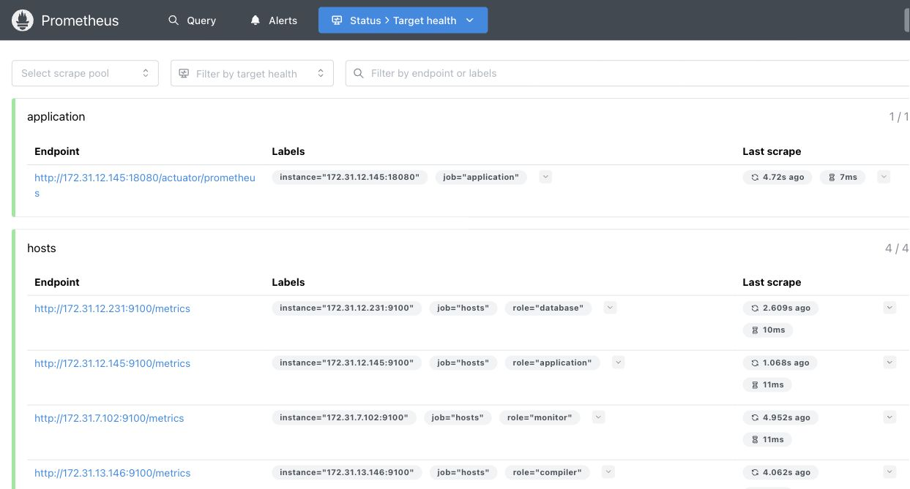

## 3.4　功能与索引验收

两条实现分别通过14项HTTP检查，覆盖固定数据查询、分页互斥、空结果、负页码、页大小、非法级别、正文超长、UTC毫秒精度及时间区间边界。固定查询的主键顺序与生成器计算的预期值一致。MySQL的EXPLAIN和MongoDB的执行计划保存在evidence目录，用于核对联合索引的使用。

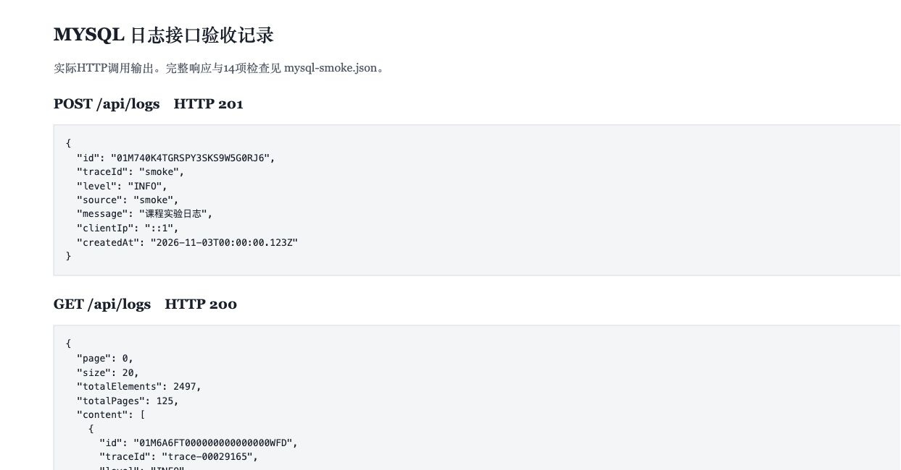

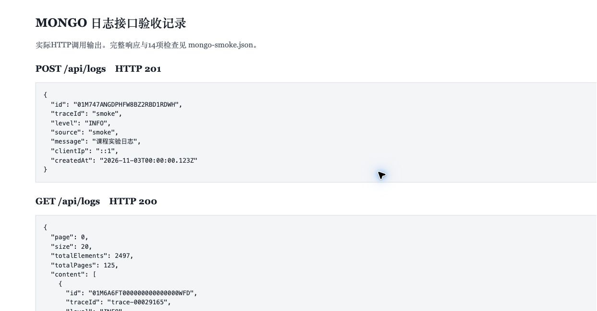

## 3.5　数据库记录与索引

下图展示两轮压测结束后数据库中保留的记录总数及实际日志节选。记录总数与最后一次写入测试的成功请求数对应，正文节选用于核对字段落库情况。

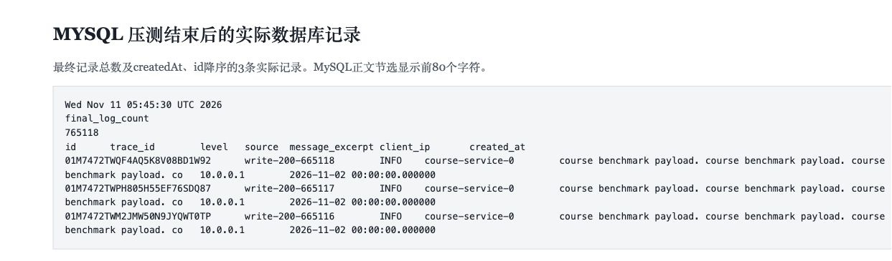

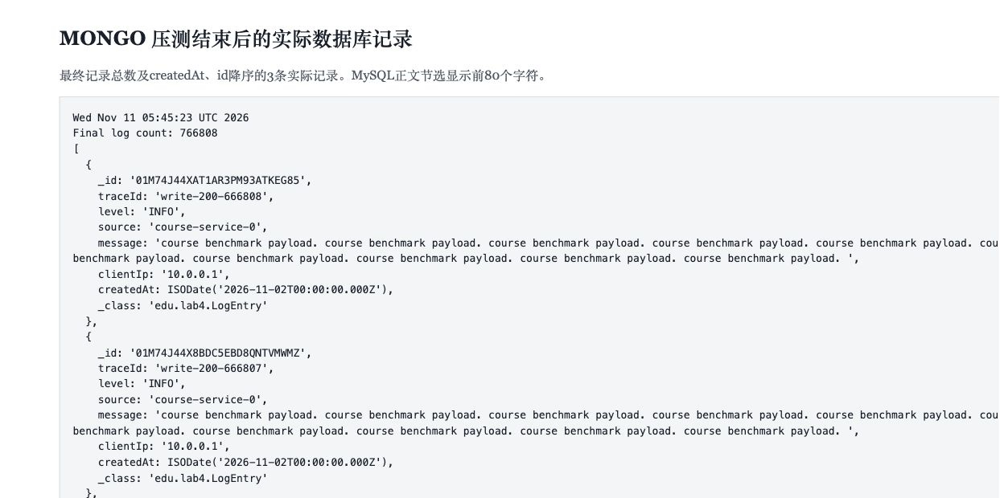

### 联合索引与执行计划

MySQL联合索引列为level、created_at、id；MongoDB联合索引列为level、createdAt、_id。两条读取链路按相同条件和排序返回数据，执行计划原文保存在evidence目录。

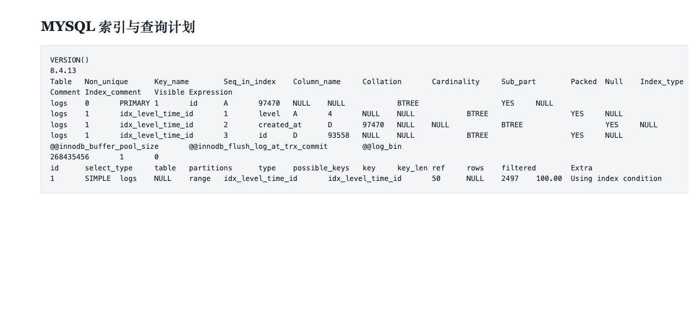

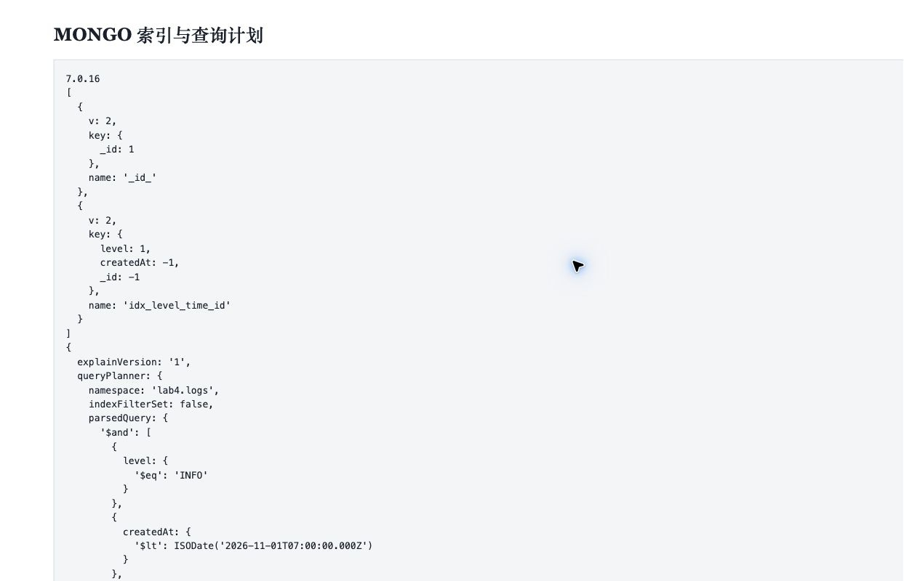

# 4　实验结果与分析

## 4.1　查询负载测试

表中吞吐量和延迟均为同档3次测量的中位数，完整平均值、P50/P95/P99和各次结果保存在results/aggregate.csv与all-runs.csv。200线程时，MySQL的吞吐量为1,258.0次/秒、P95为305.0 ms；MongoDB的吞吐量为1,167.8次/秒、P95为258.0 ms。

表3　查询性能汇总

| 线程 | MySQL
次/秒 | P95
ms | P99
ms | MongoDB
次/秒 | P95
ms | P99
ms |
| --- | --- | --- | --- | --- | --- | --- |
| 1 | 373.3 | 3.0 | 4.0 | 419.3 | 3.0 | 3.0 |
| 10 | 1198.1 | 12.0 | 15.0 | 1248.8 | 13.0 | 16.0 |
| 25 | 1304.7 | 30.0 | 36.0 | 1271.2 | 32.0 | 38.0 |
| 50 | 1307.4 | 73.0 | 109.0 | 1270.1 | 57.0 | 67.0 |
| 100 | 1285.8 | 145.0 | 210.0 | 1249.7 | 122.0 | 149.0 |
| 200 | 1258.0 | 305.0 | 444.0 | 1167.8 | 258.0 | 328.0 |

本组MySQL正式请求错误数为0，MongoDB为0。两种实现各档的3次测量错误率均为0%。图中的误差线体现重复测量的波动，吞吐量曲线与P95曲线共同反映并发增加后的收益和延迟代价。

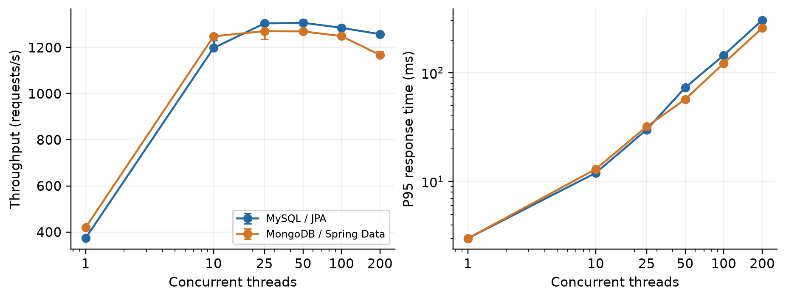

在200线程档，MongoDB相对MySQL的吞吐量低7.2%、P95低15.4%。

在已测档位中，MySQL的最高中位吞吐量为1,307.4次/秒，对应50线程、P95为73.0 ms；MongoDB的最高中位吞吐量为1,271.2次/秒，对应25线程、P95为32.0 ms。

### 查询响应时间曲线

1线程下，MySQL三次测量的P50/P95/P99中位数为3.0/3.0/4.0 ms，MongoDB为2.0/3.0/3.0 ms。下图展示第1次重复，趋势图按5秒窗口计算均值，百分位曲线使用该次正式窗口内全部响应时间。

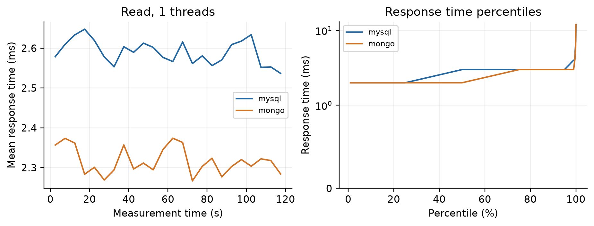

25线程下，MySQL三次测量的P50/P95/P99中位数为18.0/30.0/36.0 ms，MongoDB为19.0/32.0/38.0 ms。下图展示第1次重复，趋势图按5秒窗口计算均值，百分位曲线使用该次正式窗口内全部响应时间。

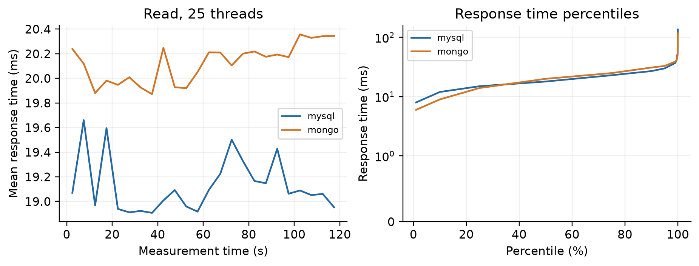

### 查询高并发与资源占用

200线程下，MySQL三次测量的P50/P95/P99中位数为158.0/305.0/444.0 ms，MongoDB为170.0/258.0/328.0 ms。下图展示第1次重复，趋势图按5秒窗口计算均值，百分位曲线使用该次正式窗口内全部响应时间。

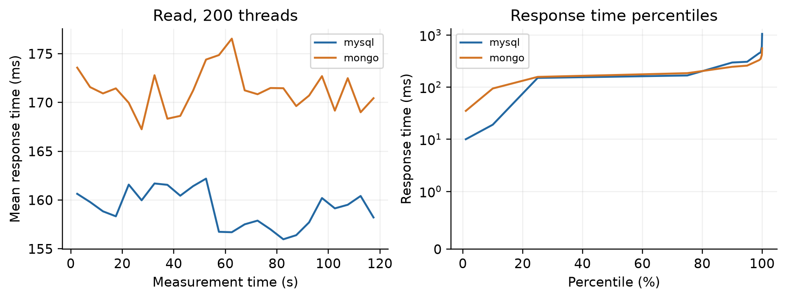

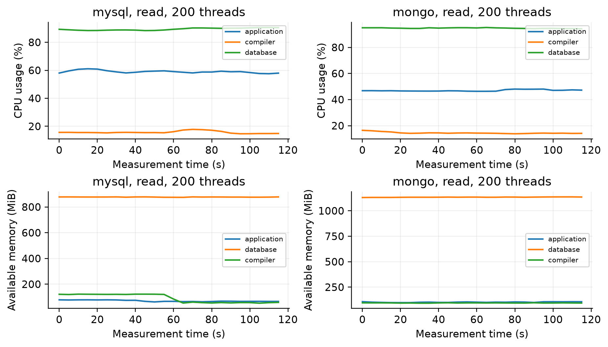

按压测机、应用机、数据库机顺序，三机平均CPU使用率为：MySQL为15.7%/59.0%/89.4%（压测机最小可用内存52.4 MiB）；MongoDB为14.5%/47.0%/94.8%（压测机最小可用内存92.8 MiB）。资源序列与延迟曲线采用同一正式窗口。

两组运行中CPU占用最高的环节分别为MySQL的数据库机（89.4%）、MongoDB的数据库机（94.8%）。结合吞吐平台和P95增长，可以定位增加并发后资源压力集中的环节。

## 4.2　写入负载测试

表中吞吐量和延迟均为同档3次测量的中位数，完整平均值、P50/P95/P99和各次结果保存在results/aggregate.csv与all-runs.csv。200线程时，MySQL的吞吐量为4,608.5次/秒、P95为123.0 ms；MongoDB的吞吐量为4,236.2次/秒、P95为94.0 ms。

表4　写入性能汇总

| 线程 | MySQL
次/秒 | P95
ms | P99
ms | MongoDB
次/秒 | P95
ms | P99
ms |
| --- | --- | --- | --- | --- | --- | --- |
| 1 | 608.6 | 2.0 | 3.0 | 689.3 | 3.0 | 3.0 |
| 10 | 3909.9 | 4.0 | 5.0 | 3214.2 | 4.0 | 6.0 |
| 25 | 4556.2 | 10.0 | 14.0 | 4612.8 | 8.0 | 11.0 |
| 50 | 5136.9 | 22.0 | 32.0 | 4475.3 | 18.0 | 23.0 |
| 100 | 4117.8 | 63.0 | 108.0 | 4342.3 | 44.0 | 61.0 |
| 200 | 4608.5 | 123.0 | 200.0 | 4236.2 | 94.0 | 135.0 |

本组MySQL正式请求错误数为0，MongoDB为0。两种实现各档的3次测量错误率均为0%。图中的误差线体现重复测量的波动，吞吐量曲线与P95曲线共同反映并发增加后的收益和延迟代价。

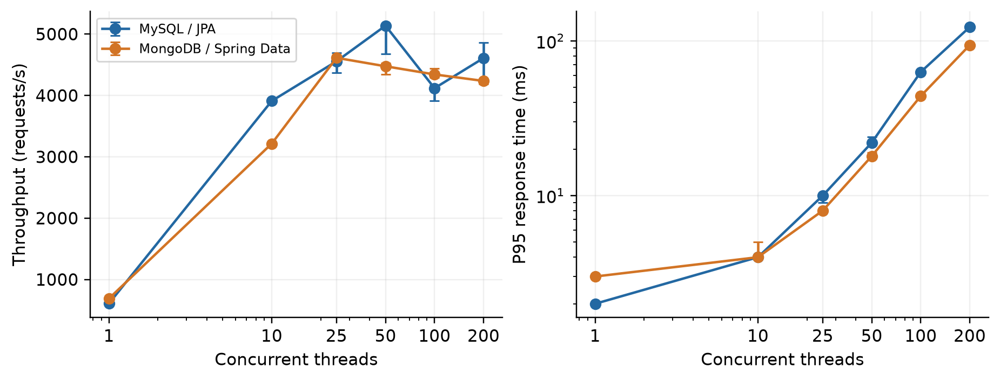

在200线程档，MongoDB相对MySQL的吞吐量低8.1%、P95低23.6%。

在已测档位中，MySQL的最高中位吞吐量为5,136.9次/秒，对应50线程、P95为22.0 ms；MongoDB的最高中位吞吐量为4,612.8次/秒，对应25线程、P95为8.0 ms。

### 写入响应时间曲线

1线程下，MySQL三次测量的P50/P95/P99中位数为2.0/2.0/3.0 ms，MongoDB为1.0/3.0/3.0 ms。下图展示第1次重复，趋势图按5秒窗口计算均值，百分位曲线使用该次正式窗口内全部响应时间。

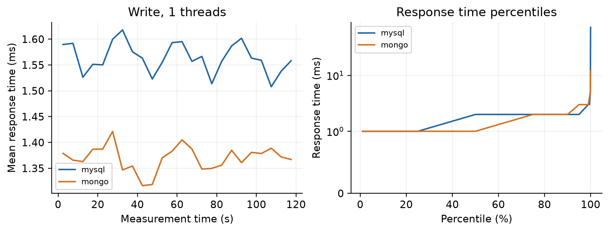

50线程下，MySQL三次测量的P50/P95/P99中位数为8.0/22.0/32.0 ms，MongoDB为11.0/18.0/23.0 ms。下图展示第1次重复，趋势图按5秒窗口计算均值，百分位曲线使用该次正式窗口内全部响应时间。

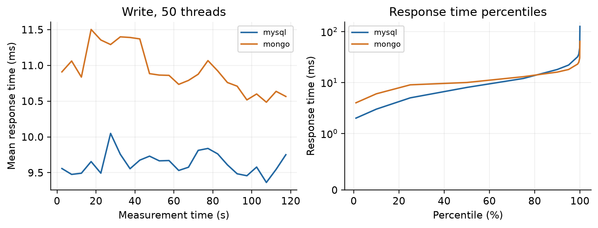

### 写入高并发与资源占用

200线程下，MySQL三次测量的P50/P95/P99中位数为33.0/123.0/200.0 ms，MongoDB为46.0/94.0/135.0 ms。下图展示第1次重复，趋势图按5秒窗口计算均值，百分位曲线使用该次正式窗口内全部响应时间。

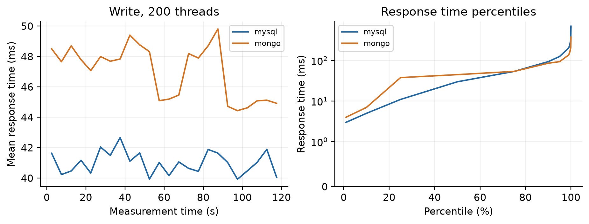

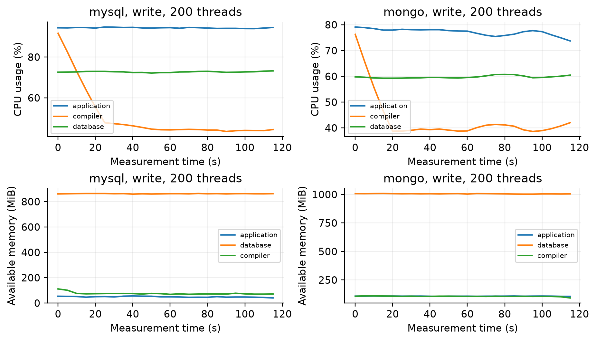

按压测机、应用机、数据库机顺序，三机平均CPU使用率为：MySQL为50.8%/94.3%/72.7%（压测机最小可用内存68.9 MiB）；MongoDB为43.3%/77.2%/59.8%（压测机最小可用内存92.4 MiB）。资源序列与延迟曲线采用同一正式窗口。

两组运行中CPU占用最高的环节分别为MySQL的应用机（94.3%）、MongoDB的应用机（77.2%）。结合吞吐平台和P95增长，可以定位增加并发后资源压力集中的环节。

## 4.3　JMeter原始报告页面

下图直接截取200线程第1次重复的JMeter HTML报告。每页保留同一实现的趋势与百分位曲线，完整页面原图保存在screenshots目录。

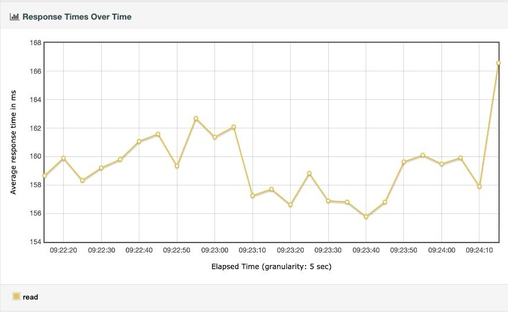

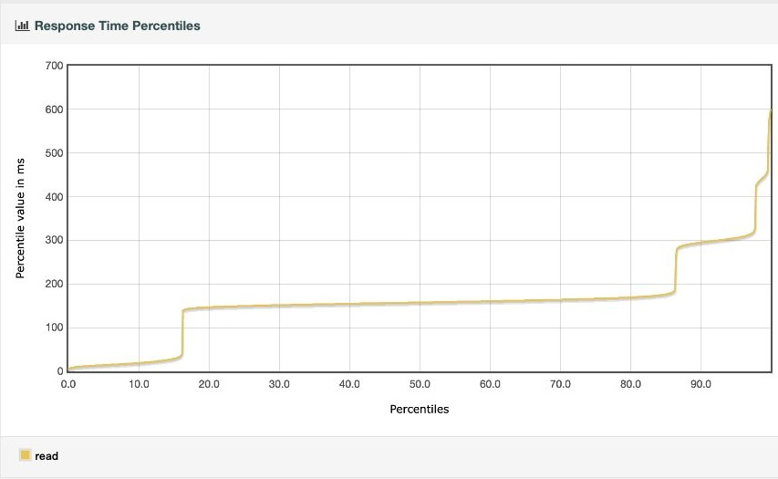

### MongoDB 查询 JMeter页面

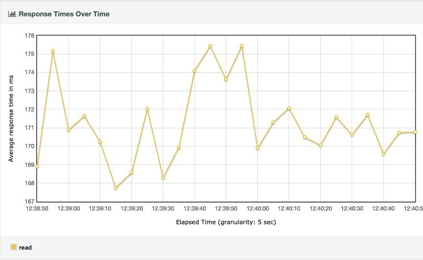

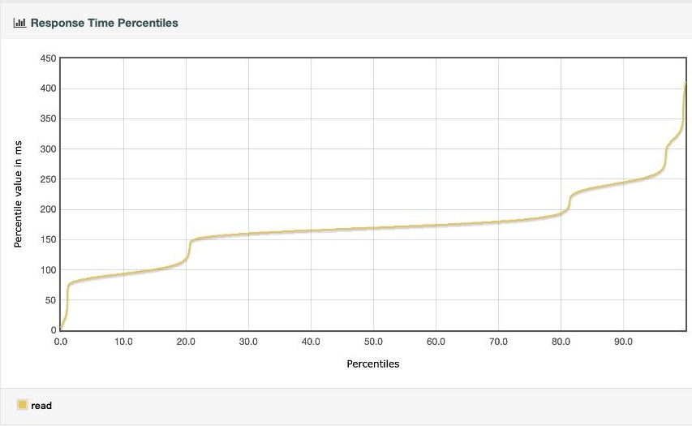

### MySQL 写入 JMeter页面

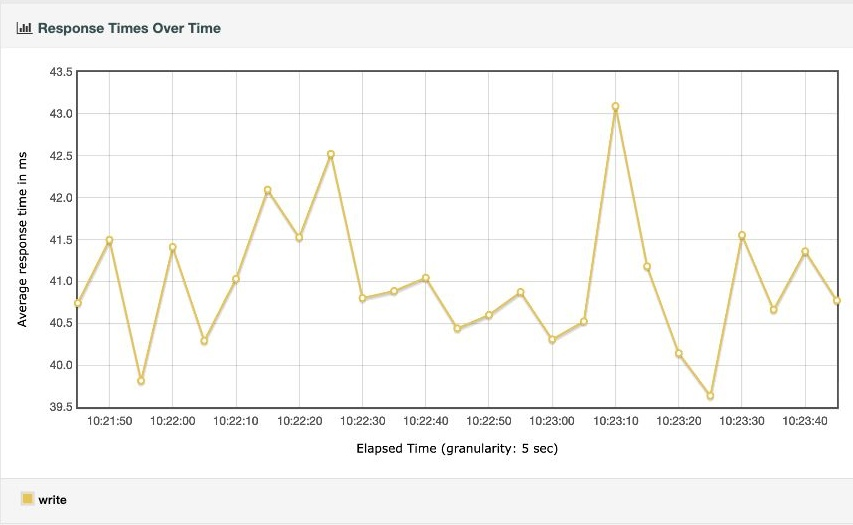

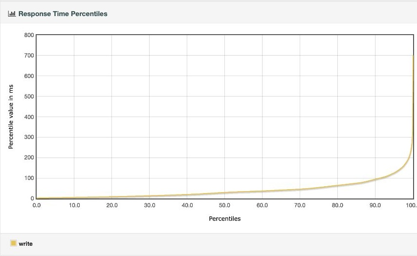

### MongoDB 写入 JMeter页面

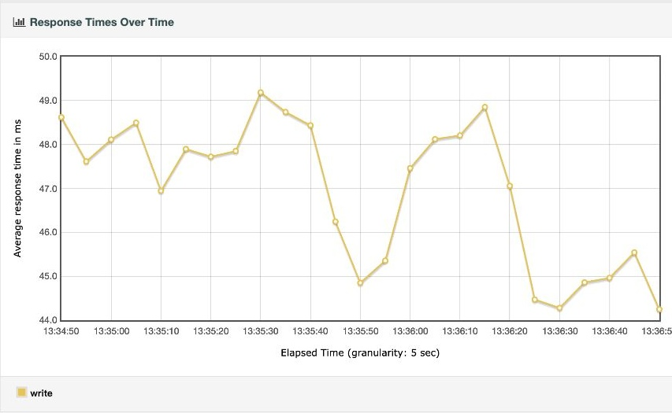

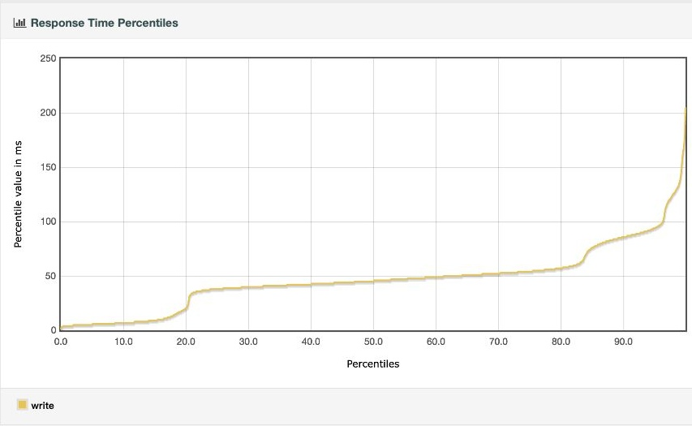

# 5　总结

本实验完成了同一日志模型和接口下的JPA/MySQL与Spring Data MongoDB/MongoDB对照实现，并在四台云主机上通过两轮部署完成72次正式测量。200线程时，MySQL的吞吐量为1,258.0次/秒、P95为305.0 ms；MongoDB的吞吐量为1,167.8次/秒、P95为258.0 ms。200线程时，MySQL的吞吐量为4,608.5次/秒、P95为123.0 ms；MongoDB的吞吐量为4,236.2次/秒、P95为94.0 ms。这些结果描述了本实验硬件、查询选择率、索引、连接池和写入确认设置下的应用链路表现。

查询返回20条数据并计算2497条匹配记录的总数，写入采用单条持久化并等待确认；两类操作承担不同的数据库工作。并发增加后的性能变化应结合吞吐量、P95/P99和主机资源判断。本文保留重复测量范围、原始错误和资源序列，使读写差异及性能转折均可追溯到具体运行。

表5　实验完成与数据核验

| 核验项目 | 结果 |
| --- | --- |
| 正式测量 | 72次，24个实现与操作并发组合，各重复3次 |
| 正式请求数 | 20,730,914 |
| 正式错误数 | 0 |
| 记录数核对 | 全部运行均完成核对 |
| 原始数据 | 升压预热、正式窗口、收尾JTL无损压缩及SHA-256 |
| 程序与材料 | https://github.com/Baakarshan/mysql-mongodb-log-lab4 |

## 参考文献

[1] Spring. Spring Data JPA Reference Documentation. https://docs.spring.io/spring-data/jpa/reference/.

[2] Spring. Spring Data MongoDB Reference Documentation. https://docs.spring.io/spring-data/mongodb/reference/.

[3] Apache Software Foundation. Apache JMeter User Manual: Generating Dashboard Report. https://jmeter.apache.org/usermanual/generating-dashboard.html.

[4] MongoDB. Write Concern. https://www.mongodb.com/docs/v7.0/reference/write-concern/.

[5] Oracle. MySQL 8.4 Reference Manual: InnoDB Startup Options and System Variables. https://dev.mysql.com/doc/refman/8.4/en/innodb-parameters.html.
