MySQL 与 MongoDB 日志读写性能对比

温子健

摘　要：本文使用相同日志模型与REST接口，比较Spring Data JPA/MySQL和Spring Data MongoDB/MongoDB链路。四台服务器分两轮复用，每次测量恢复10万条初始数据。JMeter采用有限循环与吞吐量定时器，从低并发逐级增加负载，依据响应时间、吞吐量、错误和压测机资源决定后续档位，并复测突降与边界。共完成75次测量，正式窗口记录2,149,609次请求、154,870次错误。结合Hits Per Second、延迟分布及Prometheus数据，分析稳定负载范围、饱和后的排队与失效条件。

关键词：MySQL；MongoDB；Spring Data；渐进加压；JMeter；Prometheus

Log Read and Write Performance of MySQL and MongoDB

CHIKIN WEN

Abstract: This experiment compares JPA/MySQL and Spring Data MongoDB using the same log model and REST API. Four servers are reused in two sequential rounds. Finite JMeter loops and throughput pacing provide controlled workloads. Concurrency increases according to observed latency, throughput, errors and generator resources. Drops and failure boundaries are retested. The experiment includes 75 runs and 2,149,609 measured requests, with 154,870 errors. Request-rate traces and Prometheus metrics support the analysis of stable load, saturation and failures.

Key words: MySQL; MongoDB; Spring Data; progressive load; JMeter; Prometheus

# 1　问题描述

日志服务持续写入事件，并按级别及时间区间查询。实验首先观察稳定负载下的响应时间和资源使用，再逐级提高并发寻找吞吐平台、明显退化与失败。遇到吞吐突降时，复测相邻档并检查应用、数据库和压测机，区分真实系统行为、配置故障和压测端限制。

# 2　环境与实现

表1　四机两轮环境

| 主机 | 配置 | 角色 |
| --- | --- | --- |
| Compiler | 2核，792 MiB | Java 17、JMeter 5.6.3 |
| Node1 | 2核，1800 MiB | MySQL 8.4.13 / MongoDB 7.0.16 |
| Node2 | 2核，792 MiB | Spring Boot 3.3.13，堆256 MiB |
| Manager | 2核，1800 MiB | Prometheus 3.7.3；高并发补测发压 |

两库在Node1先后运行，数据库缓存预算约256 MiB、容器内存上限1 GiB；应用最大连接数20。MySQL每次事务提交刷盘并关闭二进制日志，MongoDB采用单机WiredTiger与w=1、journal=true。压测期间暂停同机RBAC服务，保留数据，测量后恢复原副本数。两轮使用同一个修正仓储扫描范围后的JAR。Compiler达到资源限制后，使用Manager补测高并发；应用、数据库与JMX保持一致，Prometheus维持5秒采样。Manager初用256 MiB发压堆，2916线程JMeter堆耗尽后扩为512 MiB；两库按相同发压机与堆上限比较，每次运行记录配置。

公共字段为id、traceId、level、source、message、clientIp、createdAt。服务端生成26位ULID，UTC时间统一到毫秒，正文上限4096字符。POST /api/logs返回201；GET按level与[from,to)分页，按createdAt和id降序，返回当前页与总数。MySQL与MongoDB分别建立级别、时间、主键联合索引。

# 3　测试方法

同一生成器以固定随机种子产生10万条日志。读取固定INFO级别、2026年11月1日UTC 06:00至07:00、第一页20条，匹配2497条；写入采用固定长度正文。每次测量前重置数据，避免不同起始规模影响对照。

JMeter采用最多600次有限循环，每档升压5秒、预热5秒、正式测量25秒；退出宽限30秒。原生吞吐量定时器按当前线程组计算目标速率，并由各线程分别控制节奏，初始目标到达率为线程数×10次/秒。正式窗口按请求开始时间截取，完整JTL保留升压、预热和收尾请求。原始时间戳为Unix毫秒，原生HTML与截图显示北京时间。循环上限保证测试有界，请求节奏由定时器控制；饱和后实际速率与目标速率的偏离作为结果记录。

从8线程开始探索。未接近饱和时下一档约加倍；实际吞吐落后目标或延迟升高时改用较小增幅。吞吐较前档下降超过20%时复测原档和前档。错误率达到10%或P95达到3500 ms时复测确认；进程或健康检查失败单独记录。压测机CPU接近饱和、可用内存低于32 MiB或JMeter异常时停止该轮，单独标注发生在压测端的限制。

探索、确认和诊断按运行目的分别汇总；恢复后短窗口与持续预热的结果分别呈现。基础负载分析使用低并发且请求节奏稳定的档位；压力分析延续同一探索过程，观察吞吐平台、排队、失败及恢复。Hits Per Second按1秒展示，正式窗口内5秒分箱计算变异系数。25秒窗口用于快速定位边界，关键档复测用于判断是否重现。

## 3.1　接口与部署验收

MySQL链路通过14次HTTP检查，覆盖分页、排序、空结果、非法字段、超长正文和毫秒时间边界，初始化查询匹配2497条。

MongoDB链路通过14次HTTP检查，覆盖分页、排序、空结果、非法字段、超长正文和毫秒时间边界，初始化查询匹配2497条。

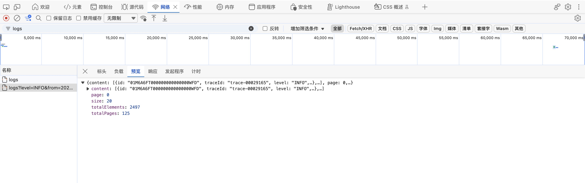

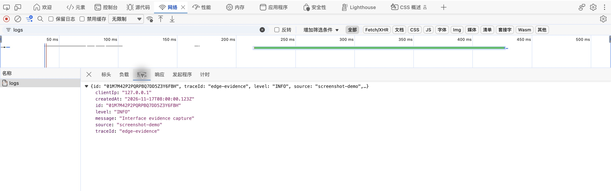

接口截图在压测完成后采集，两库分别新增1条演示日志，独立记录于interface-recapture.json。性能计数使用各档结束时的数据库快照。

# 4　稳定负载表现

低并发阶段的目标为每线程每秒10次请求。比较实际吞吐与目标值，并用5秒HPS分箱的变异系数判断节奏稳定性。毫秒级响应时间的逐秒均值有小幅跳动，需联系纵轴刻度与百分位分布判断。

## 4.1　查询负载

表2　查询低负载测量

| 实现 | 线程 | 次/秒 | P95 ms | 错误率 | HPS变异系数 |
| --- | --- | --- | --- | --- | --- |
| MySQL | 8 | 80.0 | 6.0 | 0.0% | 0.0% |
| MySQL | 16 | 160.0 | 5.0 | 0.0% | 0.0% |
| MongoDB | 8 | 80.0 | 5.0 | 0.0% | 0.0% |
| MongoDB | 16 | 158.0 | 10.0 | 0.0% | 2.3% |

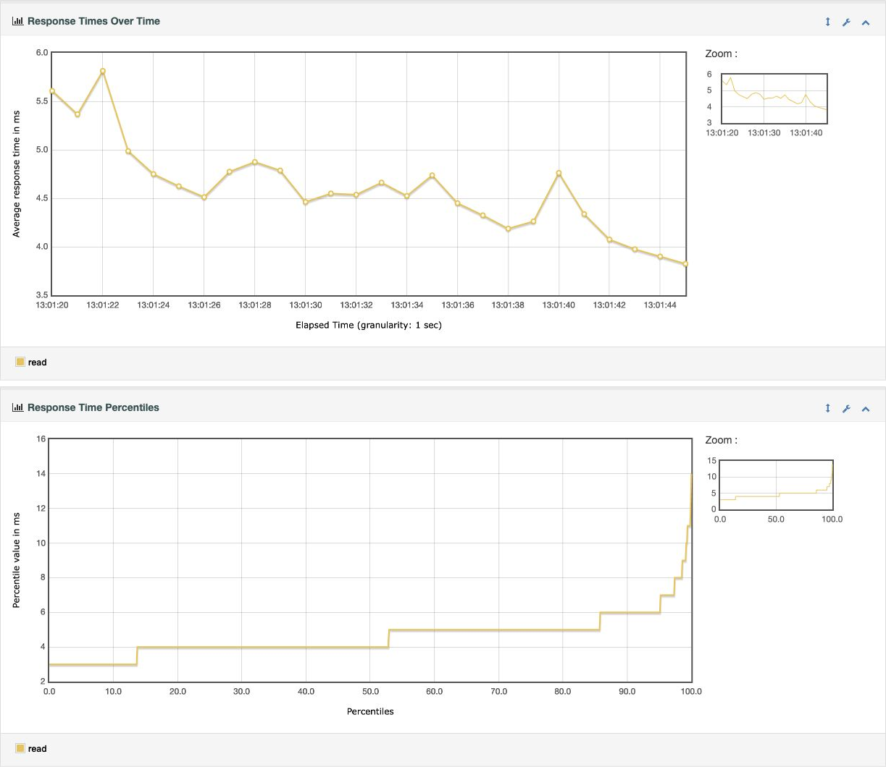

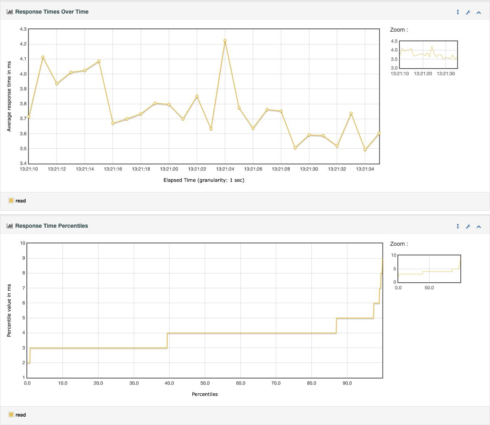

## 4.2　写入负载

表3　写入低负载测量

| 实现 | 线程 | 次/秒 | P95 ms | 错误率 | HPS变异系数 |
| --- | --- | --- | --- | --- | --- |
| MySQL | 8 | 80.0 | 3.0 | 0.0% | 0.0% |
| MySQL | 16 | 160.0 | 3.0 | 0.0% | 0.1% |
| MongoDB | 8 | 80.0 | 4.0 | 0.0% | 0.0% |
| MongoDB | 16 | 160.0 | 3.0 | 0.0% | 0.0% |

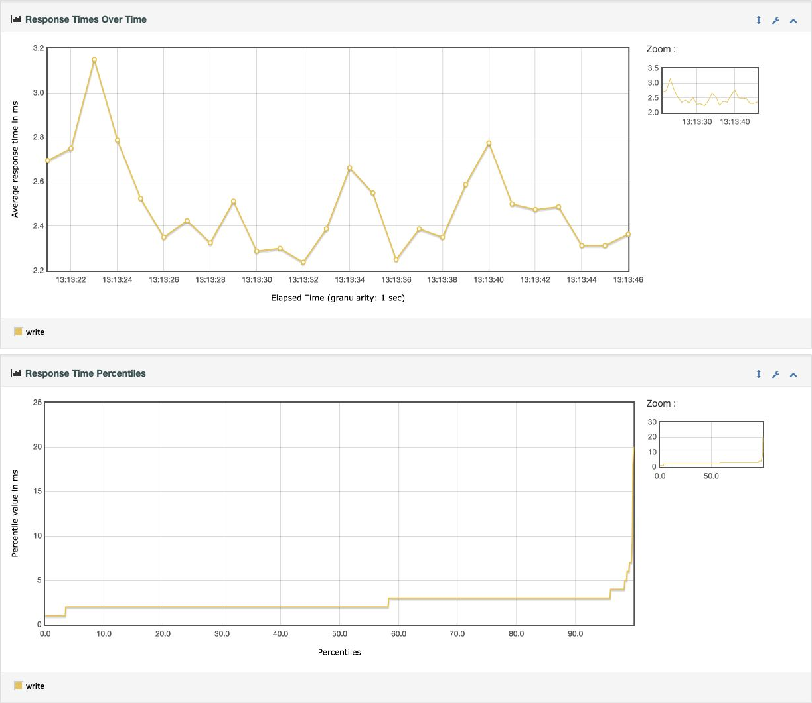

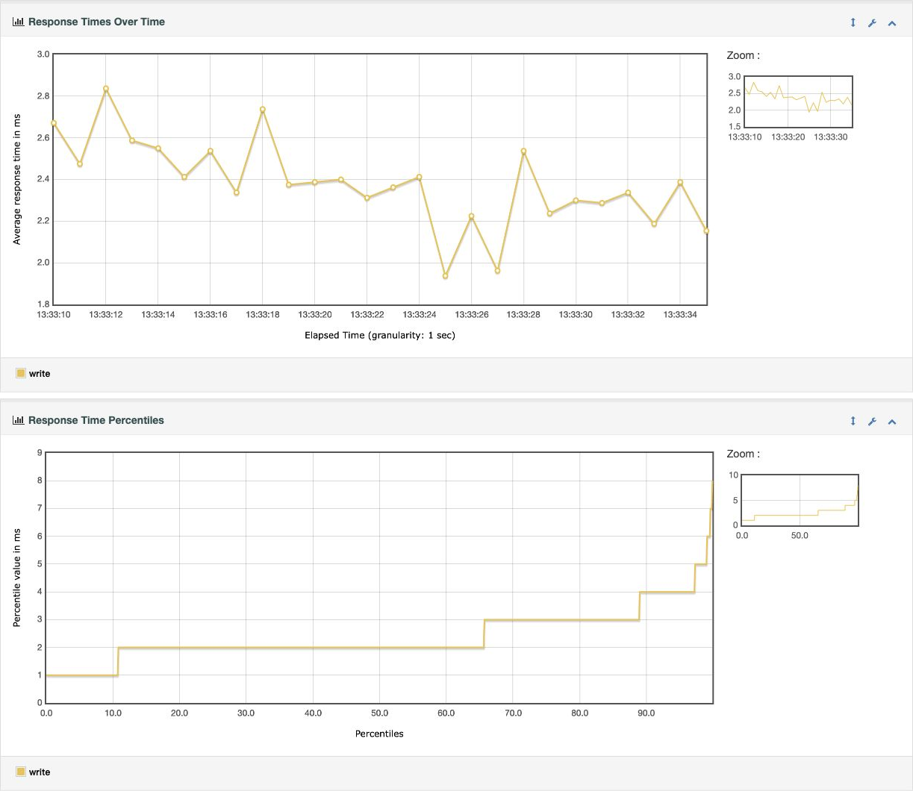

# 5　逐级压力与异常排查

## 5.1　查询逐级加压

表4　查询探索档实测，重复探索取中位数

| 实现 | 发压机 | 线程 | 次数 | 成功次/秒 | P95 ms | 错误率 |
| --- | --- | --- | --- | --- | --- | --- |
| MongoDB | C/256 | 8 | 1 | 80.0 | 5.0 | 0.0% |
| MongoDB | C/256 | 16 | 1 | 158.0 | 10.0 | 0.0% |
| MongoDB | C/256 | 32 | 1 | 320.0 | 7.0 | 0.0% |
| MongoDB | C/256 | 64 | 1 | 640.0 | 7.0 | 0.0% |
| MongoDB | C/256 | 128 | 1 | 1,146.0 | 160.0 | 0.0% |
| MongoDB | C/256 | 256 | 1 | 1,077.2 | 395.0 | 0.0% |
| MongoDB | C/256 | 384 | 1 | 1,082.7 | 510.0 | 0.0% |
| MongoDB | M/256 | 384 | 1 | 1,115.6 | 499.0 | 0.0% |
| MongoDB | C/256* | 576 | 1 | 90.1 | 4,015.0 | 0.0% |
| MongoDB | M/256 | 576 | 1 | 1,097.7 | 680.0 | 0.0% |
| MongoDB | M/256 | 864 | 1 | 1,118.2 | 930.0 | 0.0% |
| MongoDB | M/256 | 1296 | 1 | 1,150.8 | 1,277.0 | 0.0% |
| MongoDB | M/256 | 1944 | 1 | 1,219.8 | 1,820.0 | 0.0% |
| MongoDB | M/512 | 1944 | 1 | 1,130.0 | 1,882.0 | 0.0% |
| MongoDB | M/256* | 2916 | 1 | 253.8 | 2,529.8 | 0.0% |
| MongoDB | M/512 | 2916 | 1 | 0.3 | 6,009.0 | 100.0% |
| MySQL | C/256 | 8 | 1 | 80.0 | 6.0 | 0.0% |
| MySQL | C/256 | 16 | 1 | 160.0 | 5.0 | 0.0% |
| MySQL | C/256 | 32 | 1 | 320.0 | 6.0 | 0.0% |
| MySQL | C/256 | 64 | 1 | 640.0 | 9.0 | 0.0% |
| MySQL | C/256 | 128 | 1 | 1,241.6 | 125.0 | 0.0% |
| MySQL | C/256 | 256 | 1 | 1,225.2 | 605.0 | 0.0% |
| MySQL | C/256 | 384 | 1 | 1,239.4 | 745.0 | 0.0% |
| MySQL | M/512 | 384 | 1 | 423.7 | 1,584.0 | 0.0% |
| MySQL | C/256* | 576 | 1 | 129.0 | 4,022.0 | 0.0% |
| MySQL | M/512 | 576 | 1 | 1,116.9 | 1,011.0 | 0.0% |
| MySQL | M/512 | 864 | 1 | 1,228.0 | 1,143.0 | 0.0% |
| MySQL | M/512 | 1296 | 1 | 1,205.8 | 1,524.0 | 0.0% |
| MySQL | M/512 | 1944 | 1 | 0.0 | 2,034.0 | 100.0% |

发压机C为Compiler，M为Manager，斜线后为JMeter堆上限MiB。*表示该组包含发压端受限运行，用于异常排查。两库比较采用相同发压机、相同堆上限且资源未受限的运行。

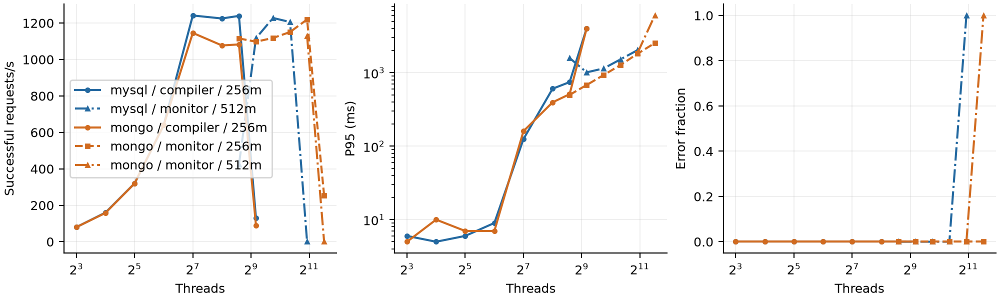

MySQL查询在1944线程时，成功吞吐量为0.4次/秒，P95为5,023.1 ms，错误率100.0%；该档标记为大量请求失败。应用测后健康检查为UP。

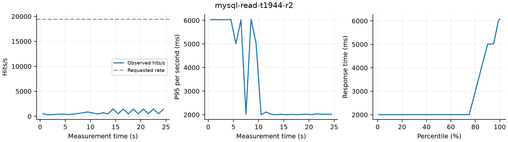

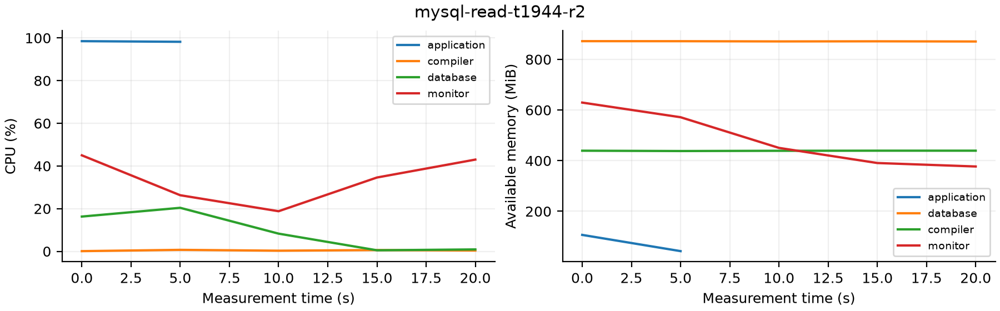

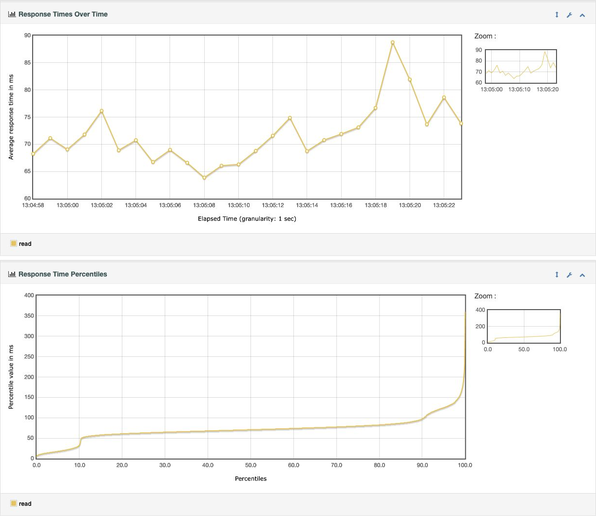

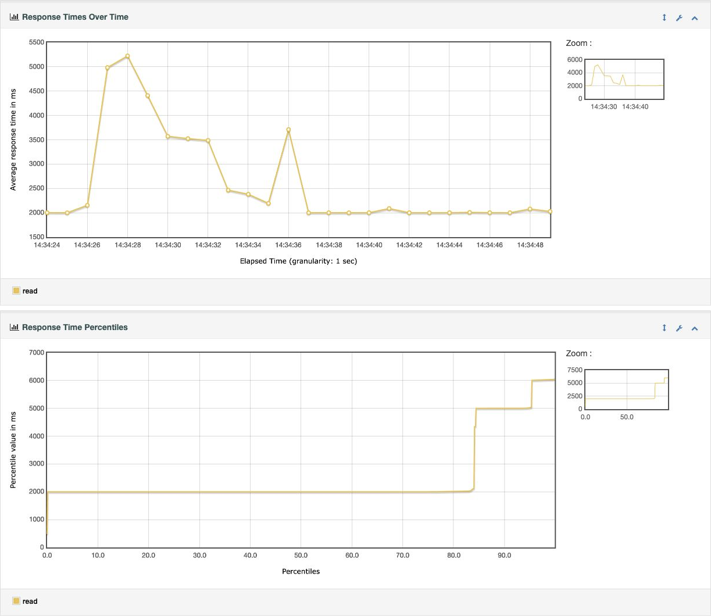

MongoDB查询在2916线程时，成功吞吐量为0.0次/秒，P95为2,088.4 ms，错误率100.0%；该档标记为大量请求失败。应用测后健康检查为失败。

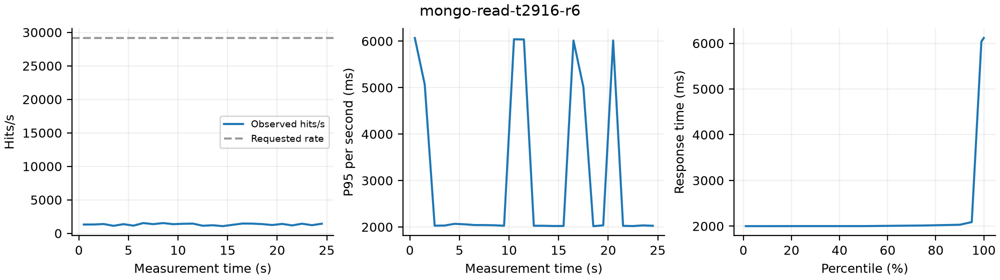

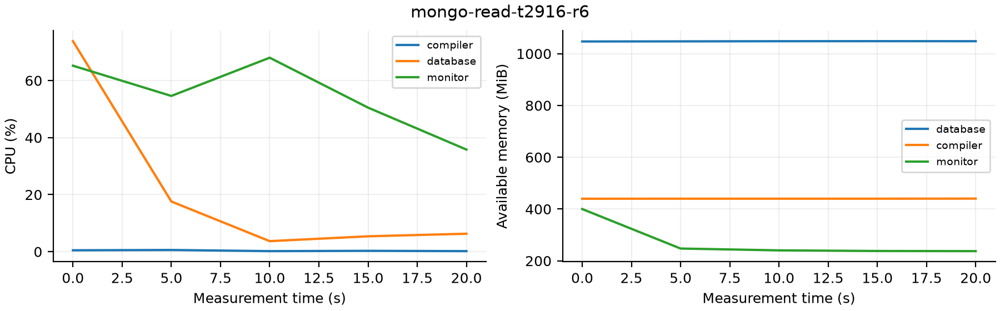

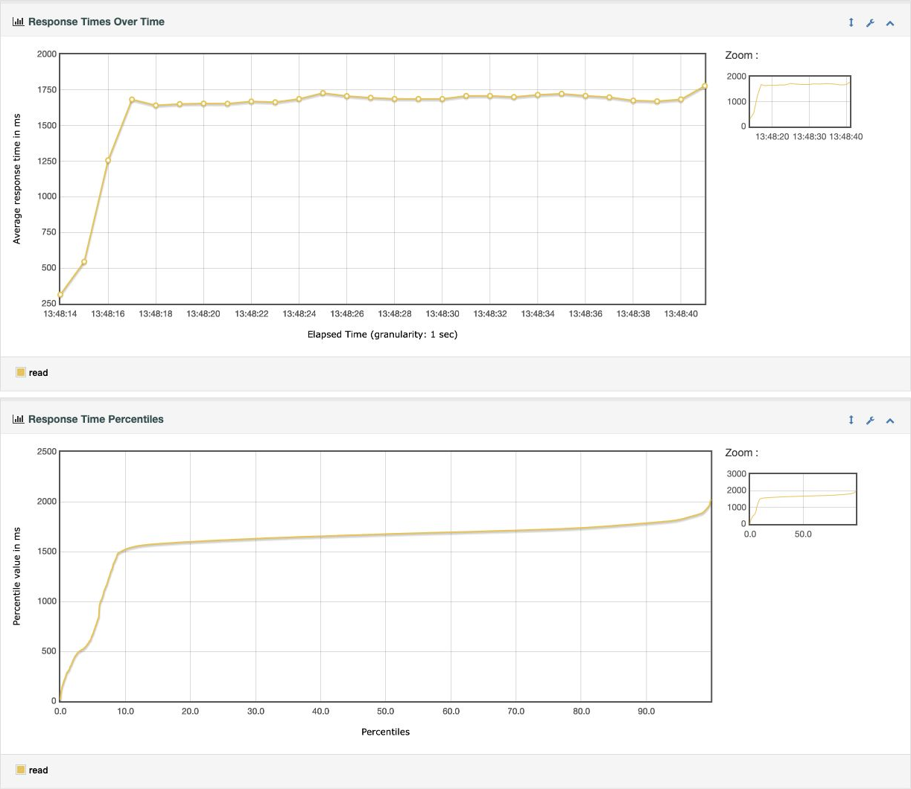

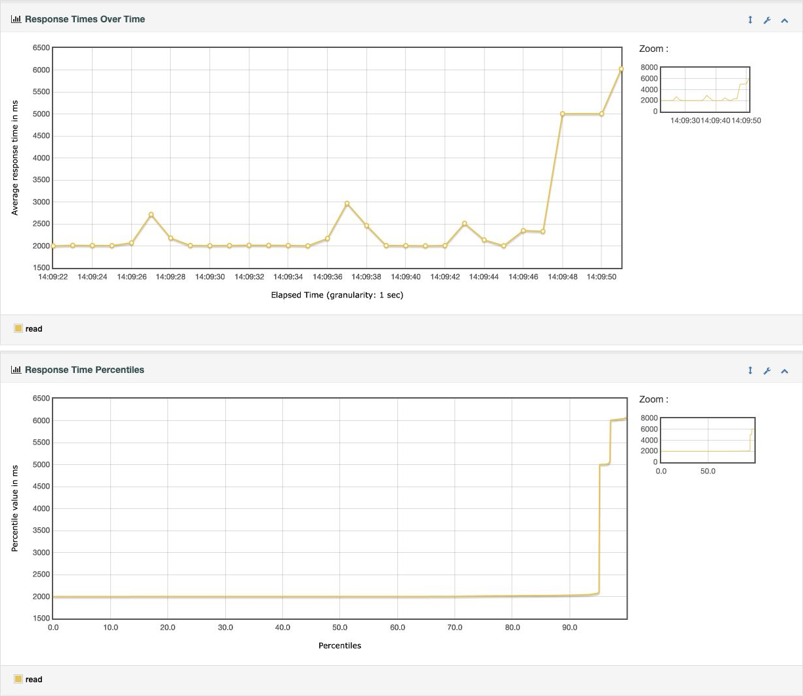

## 5.2　写入逐级加压

表5　写入探索档实测，重复探索取中位数

| 实现 | 发压机 | 线程 | 次数 | 成功次/秒 | P95 ms | 错误率 |
| --- | --- | --- | --- | --- | --- | --- |
| MongoDB | C/256 | 8 | 1 | 80.0 | 4.0 | 0.0% |
| MongoDB | C/256 | 16 | 1 | 160.0 | 3.0 | 0.0% |
| MongoDB | C/256 | 32 | 1 | 320.0 | 3.0 | 0.0% |
| MongoDB | C/256 | 64 | 1 | 640.0 | 3.0 | 0.0% |
| MongoDB | C/256 | 128 | 1 | 1,280.0 | 4.0 | 0.0% |
| MongoDB | C/256 | 256 | 1 | 2,559.8 | 8.0 | 0.0% |
| MongoDB | M/512 | 256 | 1 | 2,488.8 | 108.0 | 0.0% |
| MongoDB | C/256* | 512 | 1 | 3,488.5 | 183.0 | 0.0% |
| MongoDB | M/512 | 512 | 1 | 3,501.0 | 212.0 | 0.0% |
| MongoDB | M/512 | 768 | 1 | 3,661.5 | 285.0 | 0.0% |
| MongoDB | M/512 | 1152 | 1 | 3,541.6 | 383.0 | 0.0% |
| MongoDB | M/512* | 1728 | 1 | 3,715.6 | 502.0 | 0.0% |
| MySQL | C/256 | 8 | 1 | 80.0 | 3.0 | 0.0% |
| MySQL | C/256 | 16 | 1 | 160.0 | 3.0 | 0.0% |
| MySQL | C/256 | 32 | 1 | 320.0 | 3.0 | 0.0% |
| MySQL | C/256 | 64 | 1 | 640.0 | 3.0 | 0.0% |
| MySQL | C/256 | 128 | 1 | 1,280.1 | 3.0 | 0.0% |
| MySQL | C/256 | 256 | 1 | 2,560.4 | 8.0 | 0.0% |
| MySQL | M/512 | 256 | 1 | 1,067.0 | 483.0 | 0.0% |
| MySQL | M/512 | 384 | 1 | 3,457.5 | 71.0 | 0.0% |
| MySQL | C/256* | 512 | 1 | 4,527.9 | 138.0 | 0.0% |
| MySQL | M/512* | 768 | 1 | 3,804.6 | 103.0 | 0.0% |

发压机C为Compiler，M为Manager，斜线后为JMeter堆上限MiB。*表示该组包含发压端受限运行，用于异常排查。两库比较采用相同发压机、相同堆上限且资源未受限的运行。

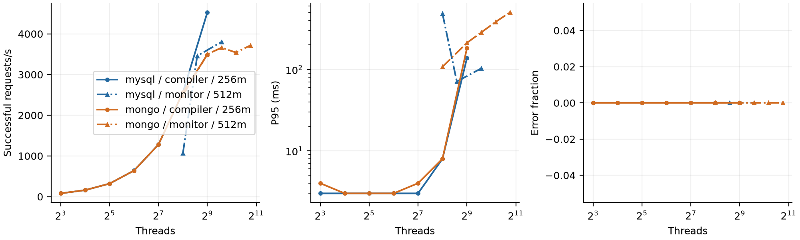

MySQL写入在768线程时，成功吞吐量为3,804.6次/秒，P95为103.0 ms，错误率0.0%；该档标记为发压端受限。应用测后健康检查为UP。

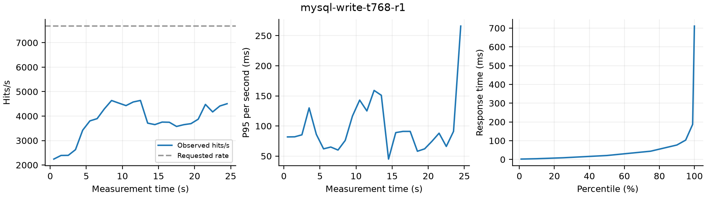

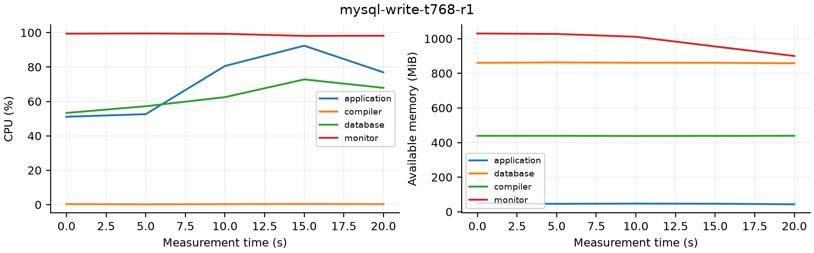

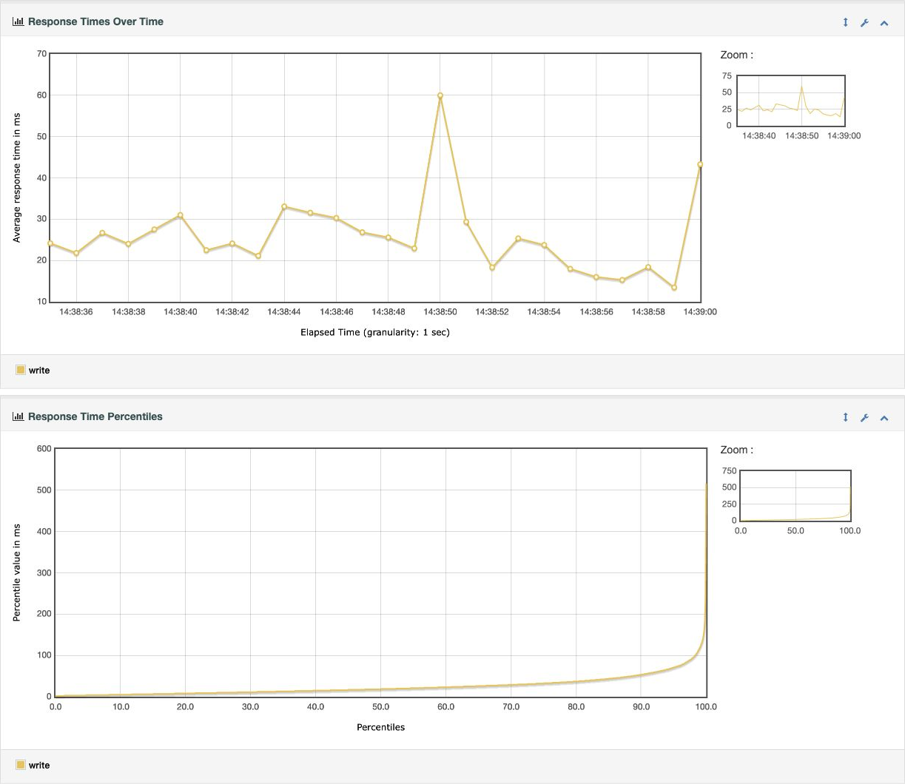

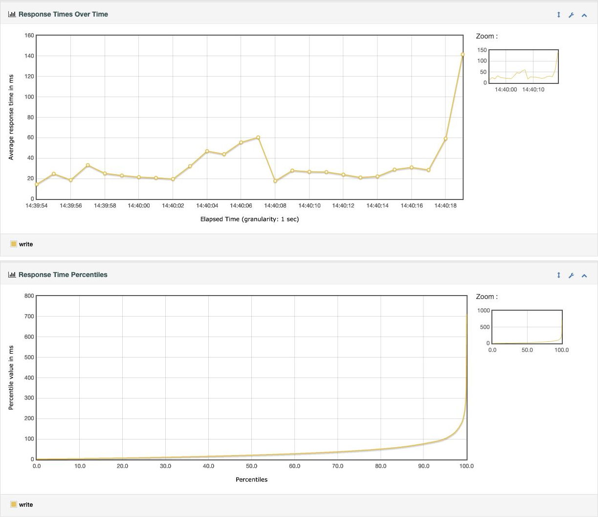

MongoDB写入在1728线程时，成功吞吐量为3,715.6次/秒，P95为502.0 ms，错误率0.0%；该档标记为发压端受限。应用测后健康检查为UP。

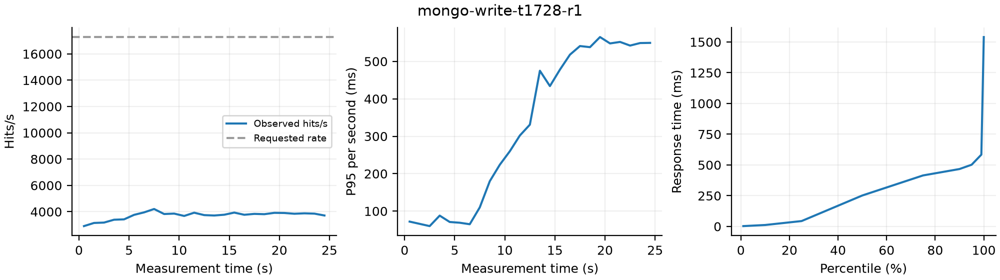

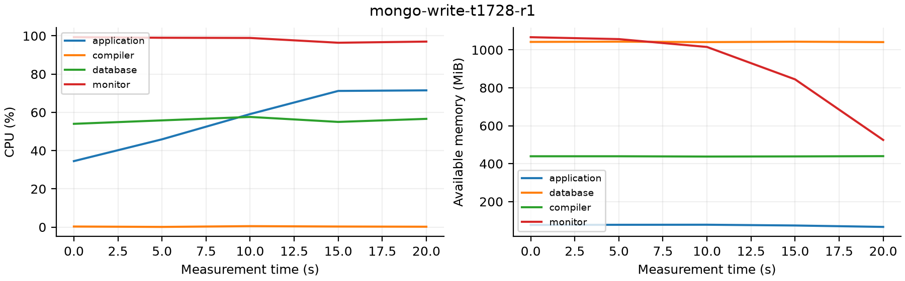

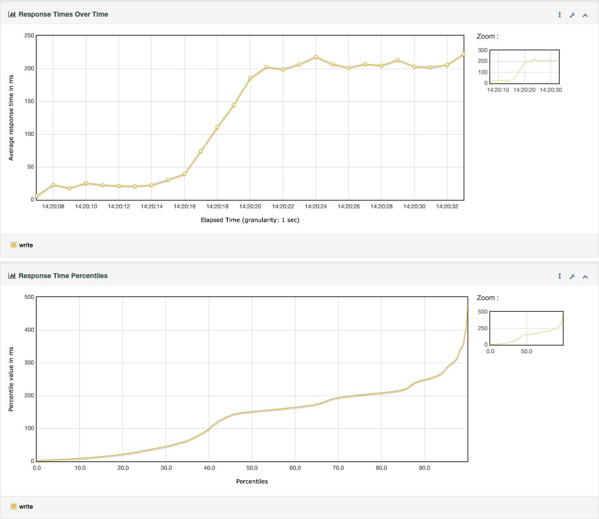

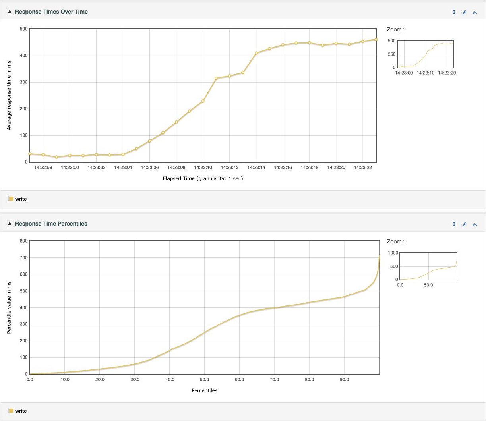

## 5.3　异常复测与定位

切换到MySQL时，公共模型同时包含JPA和MongoDB映射，JPA默认扫描将MongoRepository误识别为JPA仓储，产生findInTimeRange属性解析错误并导致启动失败。通过mysql profile下显式限定JpaRepository扫描包修复，两轮重新构建和验收。该问题属于启动配置故障。

表6　确认与诊断运行，逐次列出

| 运行 | 目的 | 次/秒 | P95 ms | 错误率 |
| --- | --- | --- | --- | --- |
| mysql-read-t384-r2 | drop_previous_retest | 1,206.8 | 762.0 | 0.0% |
| mysql-read-t576-r2 | drop_current_retest | 23.6 | 9,944.6 | 0.0% |
| mysql-read-t576-r3 | failure_confirmation | 60.9 | 3,944.0 | 0.0% |
| mysql-read-t128-r2 | peak_confirmation | 1,275.3 | 75.0 | 0.0% |
| mongo-read-t384-r2 | drop_previous_retest | 1,103.3 | 501.0 | 0.0% |
| mongo-read-t576-r2 | drop_current_retest | 119.7 | 8,884.0 | 0.0% |
| mongo-read-t128-r2 | peak_confirmation | 1,235.8 | 124.0 | 0.0% |
| mongo-read-t8-r2 | baseline_confirmation | 80.0 | 4.0 | 0.0% |
| mongo-write-t8-r2 | baseline_confirmation | 80.0 | 3.0 | 0.0% |
| mongo-read-t1944-r2 | drop_previous_retest | 1,139.9 | 1,850.0 | 0.0% |
| mongo-read-t2916-r2 | drop_current_retest | 411.5 | 2,750.6 | 0.0% |
| mongo-read-t1944-r3 | peak_confirmation | 1,149.7 | 1,842.0 | 0.0% |
| mongo-read-t384-r4 | baseline_confirmation | 1,189.0 | 465.0 | 0.0% |
| mongo-read-t1944-r5 | drop_previous_retest | 0.2 | 5,020.0 | 100.0% |
| mongo-read-t2916-r4 | drop_current_retest | 0.0 | 6,009.0 | 100.0% |
| mongo-read-t1944-r6 | manual_diagnosis | 703.5 | 4,100.0 | 1.7% |
| mongo-read-t2916-r6 | manual_diagnosis | 0.0 | 2,088.4 | 100.0% |
| mongo-read-t8-r3 | manual_diagnosis | 80.0 | 6.0 | 0.0% |
| mongo-write-t256-r3 | baseline_confirmation | 2,561.7 | 9.0 | 0.0% |
| mysql-read-t1296-r2 | drop_previous_retest | 109.9 | 5,184.1 | 61.1% |
| mysql-read-t1944-r2 | drop_current_retest | 0.4 | 5,023.1 | 100.0% |
| mysql-read-t864-r2 | peak_confirmation | 373.1 | 3,890.1 | 0.0% |
| mysql-read-t384-r4 | baseline_confirmation | 304.1 | 2,062.9 | 0.0% |
| mysql-write-t256-r3 | baseline_confirmation | 2,557.5 | 10.0 | 0.0% |

Compiler的高线程运行出现内存耗尽时，吞吐量骤降而应用健康检查仍返回UP。复测相邻档后，将这些运行标记为发压端限制，并使用Manager补测；Manager在2916线程、256 MiB发压堆下出现Java heap space，扩为512 MiB后继续验证；JTL原始值全部保留。压力下的实际Hits Per Second随排队及资源饱和而波动，低负载的稳定性由定时器和实测序列验证。

发压进程退出码124表示超过计划35秒与30秒退出宽限。此类运行保留正式窗口，但标记发压端限制；结合CPU、内存、JMeter日志和应用健康判断停止原因。Manager同时运行Prometheus，CPU统计包含监控开销。

监控未返回样本时，资源图保留缺口。错误请求按原始responseCode统计。客户端超时或发压进程被终止时，部分写入已提交而完成样本尚未记录，因此同时列出成功响应数和实际记录增长，保留差额作为排查证据。完整运行数据、窗口划分和校验值见results/runs，各次结果见all-runs.csv。

表7　写入计数差异核对

| 运行 | JTL成功数 | 数据库增长 | 差额 | 退出码 |
| --- | --- | --- | --- | --- |
| mysql-write-t768-r1 | 230068 | 230407 | 339 | 124 |

表8　服务请求失败的类型与次数

| 运行 | 成功次/秒 | 错误率 | 错误类型 |
| --- | --- | --- | --- |
| mongo-read-t2916-r3 | 0.3 | 99.97% | 连接超时: 24112；读取超时: 3374 |
| mongo-read-t1944-r5 | 0.2 | 99.98% | 连接超时: 18017；读取超时: 2240 |
| mongo-read-t2916-r4 | 0.0 | 100.00% | 连接超时: 24493；读取超时: 3850 |
| mongo-read-t2916-r6 | 0.0 | 100.00% | 连接超时: 31715；读取超时: 1618 |
| mysql-read-t1944-r1 | 0.0 | 100.00% | 连接超时: 21838；读取超时: 786 |
| mysql-read-t1296-r2 | 109.9 | 61.13% | 读取超时: 4243；连接超时: 77 |
| mysql-read-t1944-r2 | 0.4 | 99.95% | 连接超时: 15304；读取超时: 2855；套接字异常: 50 |

本轮停止高压发压后仍保留排队和主机内存占用。遇到持续退化时重启应用，恢复后重做低负载检查。人工恢复期间中断的一次运行另存evidence/operator-recovery-interruption，其JTL与日志保留，性能表排除该次干预。应用机可用内存一度降至约28 MiB，Docker恢复命令退出2；结束实验Java进程释放资源后继续验证。

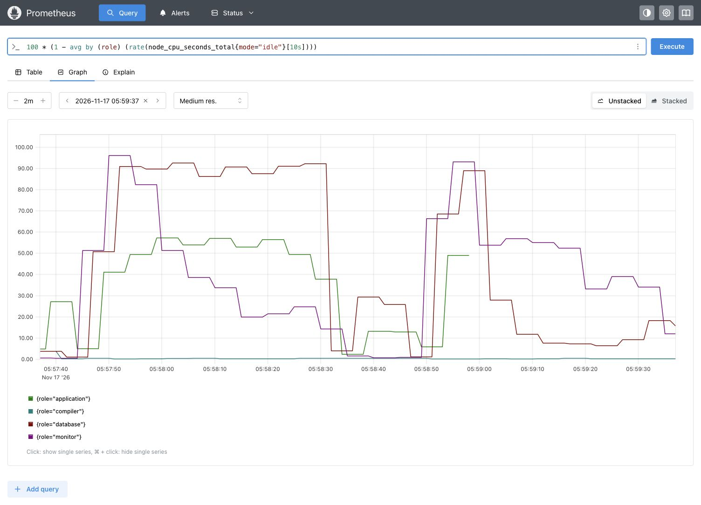

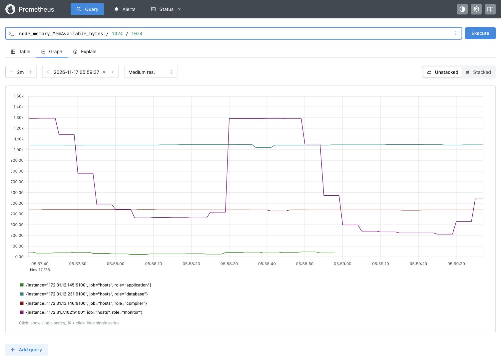

## 5.4　JMeter原生结果

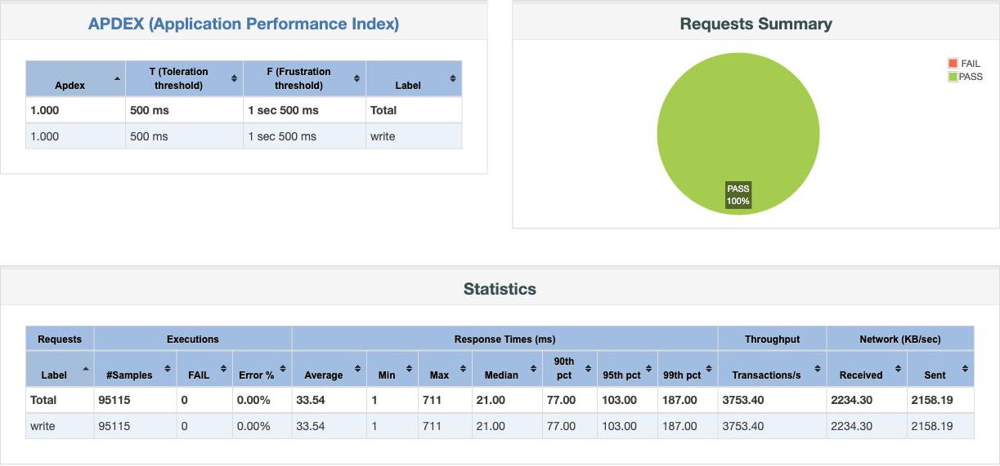

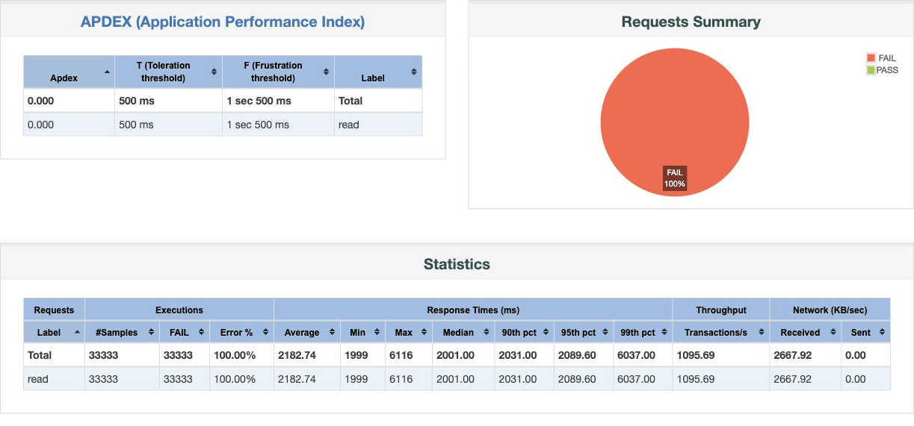

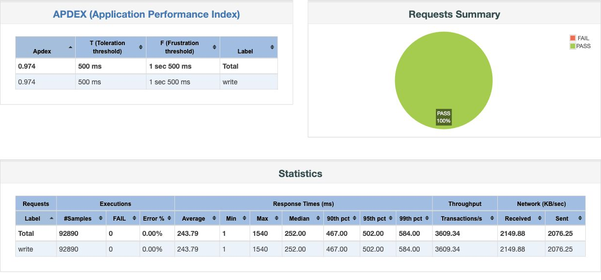

# 6　总结

采用Manager、512 MiB发压堆的共同已测1944线程查询探索档，MySQL成功吞吐为0.0次/秒、P95为2,034.0 ms、错误率100.0%；MongoDB分别为1,130.0次/秒、1,882.0 ms和0.0%。

采用Manager、512 MiB发压堆的共同已测256线程写入探索档，MySQL成功吞吐为1,067.0次/秒、P95为483.0 ms、错误率0.0%；MongoDB分别为2,488.8次/秒、108.0 ms和0.0%。

实验以有限循环和请求节奏控制完成75次逐级探索与复测，正式窗口共2,149,609次请求、154,870次错误。固定线程上限、线程耗尽、服务超时和进程退出分别记录；稳定负载、吞吐平台及失效判断由实测指标支持。两库比较应同时考虑成功吞吐量、P95/P99和压测机资源。

重启后短预热的确认运行与持续运行的探索档存在差异，确认表逐次保留这些结果。单档25秒数据用于定位转折，性能比较结合相邻档、确认结果与资源状态。写入高档多次接近发压机CPU上限，因此本轮写入边界首先反映发压能力。

查询接口承担条件过滤、20条文档/记录读取和匹配总数计算，写入等待持久化确认。结论对应本实验的数据规模、热点查询、索引、连接池和写入设置。原始JTL与监控序列可追溯到每个运行名。

## 参考文献

[1] Spring. Spring Data JPA Reference Documentation. https://docs.spring.io/spring-data/jpa/reference/.

[2] Spring. Spring Data MongoDB Reference Documentation. https://docs.spring.io/spring-data/mongodb/reference/.

[3] Apache JMeter. Component Reference: Constant Throughput Timer. https://jmeter.apache.org/usermanual/component_reference.html.

[4] MongoDB. Write Concern. https://www.mongodb.com/docs/v7.0/reference/write-concern/.
