MySQL 与 MongoDB 日志读写性能对比

温子健

摘　要：本文基于统一日志模型和REST接口，比较Spring Data JPA/MySQL与Spring Data MongoDB/MongoDB的日志读写性能。实验使用四台云主机分两轮部署，预置10万条日志，在1至200线程下测试查询与单条写入，每档重复3次。200线程时，两库查询吞吐量分别为1,258.0、1,119.7次/秒，写入吞吐量分别为4,608.5、4,142.7次/秒。72次正式测量共记录20,576,002次请求、0次错误。结合响应时间分布与资源监测，分析增加并发的吞吐收益和延迟变化。

关键词：MySQL；MongoDB；Spring Data JPA；JMeter；Prometheus

Log Read and Write Performance of MySQL and MongoDB

CHIKIN WEN

Abstract: This experiment compares Spring Data JPA/MySQL and Spring Data MongoDB/MongoDB using a shared log model and REST API. Four cloud servers are reused in two sequential rounds. Each database starts with 100,000 records. Read and write workloads use 1 to 200 concurrent threads, with three repetitions per level. JMeter measures latency, throughput and errors, while Prometheus collects resource metrics every five seconds. At 200 threads, read throughput is 1258.0 requests/s for MySQL and 1119.7 requests/s for MongoDB; write throughput is 4608.5 and 4142.7 requests/s, respectively. The analysis relates latency distributions to application, database and load-generator resource usage.

Key words: MySQL; MongoDB; Spring Data JPA; JMeter; Prometheus

# 1　问题描述

日志服务需要持续写入事件，并按日志级别和时间范围查询历史记录。本文比较关系型表与文档集合在同一Java日志业务中的读写表现，重点考察并发增加时吞吐量、响应时间分布及资源占用的变化。两条链路使用相同接口、字段、请求生成规则和JMeter断言，使对照结果对应实际应用访问过程。

# 2　实验环境与方法

## 2.1　四机两轮部署

实验采用四台Ubuntu 18.04主机。第一轮运行MySQL和JPA应用，第二轮停止MySQL并切换为MongoDB及对应应用。两轮复用相同的数据库机、应用机、内网路径和资源配置，Compiler的编译工作在压测开始前完成。

表1　服务器配置与分工

| 主机 | CPU与可见内存 | 实验角色 |
| --- | --- | --- |
| Compiler | 2核，792 MiB | Java 17编译与JMeter压测 |
| Node1 | 2核，1800 MiB | MySQL或MongoDB，分轮运行 |
| Node2 | 2核，792 MiB | 当前被测Spring应用 |
| Manager | 2核，1800 MiB | Prometheus监控 |

表2　软件与运行参数

| 项目 | 实际配置 |
| --- | --- |
| 应用 | Spring Boot 3.3.13，Java 17.0.21，堆256 MiB |
| 编译与压测 | Java 17.0.7，Maven 3.9.16，JMeter 5.6.3 |
| MySQL | 8.4.13，InnoDB缓冲池256 MiB |
| MongoDB | 7.0.16，WiredTiger缓存0.25 GiB |
| 数据库资源 | 两轮数据库容器内存上限均为1 GiB |
| 连接池 | 两条链路最大20个连接，最小5个 |
| 监控 | Prometheus 3.7.3，node_exporter 1.10.2，5秒采样 |

## 2.2　日志模型与统一接口

日志字段包括id、traceId、level、source、message、clientIp和createdAt。id采用26位ULID，createdAt统一保存UTC毫秒时间，message最长4096字符。MySQL以CHAR(26)保存主键、DATETIME(6)保存时间；MongoDB将id映射为字符串_id，以BSON Date保存时间。

POST /api/logs执行单条写入并返回HTTP 201及保存的对象。GET /api/logs接收level、from、to、page、size，按左闭右开时间范围查询，返回content、page、size、totalElements和totalPages。两套实现均按createdAt和id降序排列，并建立级别、时间、主键联合索引。

JPA实现使用EntityManager.persist写入、JpaRepository条件分页查询；MongoDB实现使用Spring Data MongoRepository的insert及条件分页查询。两条读取链路均返回当前页与匹配总数。Spring Data默认写入_class类型元数据，HTTP业务字段保持统一。MySQL每次事务提交刷盘并关闭二进制日志，MongoDB采用单机WiredTiger及w=1、journal=true写入确认。

实现核对采用老师仓库spring-fundamentals的6.SpringData_Mongo/order示例，版本854d0e0。该示例通过MongoRepository插入订单和按主键读取；本实验使用同一仓储接口实现日志写入与条件分页。2026年11月12日更新MongoDB访问实现后重新完成36次正式测量；MySQL与公共方法指令、依赖及配置核对一致，沿用原36次测量。

# 3　实验设计

## 3.1　基准数据与请求

生成器以20261111为随机种子创建10万条日志，时间均匀覆盖2026年11月1日UTC全天，包含五种级别和八个服务来源。两库导入同一批业务字段，导入后核对记录数。固定查询为INFO级别、UTC 06:00至07:00、第一页20条，匹配总数为2497条。该负载在预热后持续重复相同查询，测量包含总数计算的热点条件分页接口。写入请求使用250字符正文和固定业务时间，服务端生成ULID。

## 3.2　先负载后压力的分析方法

负载测试先考察1和10线程下的查询与写入表现；逐级压力测试随后比较1、10、25、50、100、200线程，结合吞吐平台、P95/P99增长、错误率与资源占用识别性能转折。JMeter提供外部HTTP指标，Prometheus提供主机和应用内部指标，两类指标共同用于上述测试。两章复用同一批阶梯并发测量，保留原运行时间顺序；正文按先负载、后压力组织分析。

查询与写入分别采用1、10、25、50、100、200线程，每档重复3次，两种数据库共72次正式测量。每次运行前恢复10万条基准数据，随后记录10秒升压、30秒预热和120秒正式测量。正式窗口按请求开始时间截取；窗口结束附近的收尾请求单独保留，原始HTTP采样行可完整复核。预热写入计入本次数据库增长，下一次运行前恢复基准。写入测试将全程成功请求数与数据库记录增长量核对，查询测试核对记录总数保持不变。

## 3.3　指标与监控

JMeter使用非GUI模式，保存完整HTTP响应时间及成功状态，不扣除网络连接耗时。统计每次运行的吞吐量、错误率、平均值和P50/P95/P99；各档汇总采用3次测量的中位数，误差线展示最小值至最大值。吞吐量按正式窗口请求数除以120秒计算。Prometheus同步记录主机CPU、可用内存、磁盘读写、应用堆和GC指标，并监控压测机资源。

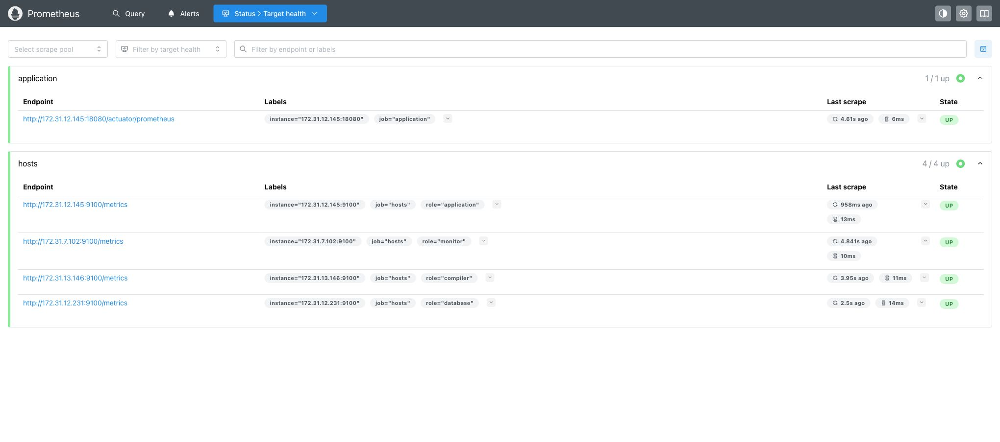

## 3.4　功能与索引验收

两条实现分别通过14项HTTP检查，覆盖固定数据查询、分页互斥、空结果、负页码、页大小、非法级别、正文超长、UTC毫秒精度及时间区间边界。固定查询的主键顺序与生成器计算的预期值一致。MySQL的EXPLAIN和MongoDB的执行计划保存在evidence目录，用于核对联合索引的使用。

接口图为补拍的Edge开发者工具Network原图，依次展示POST状态码、请求正文、保存结果与GET分页预览。本机请求客户端通过HTTP转发和SSH隧道连接Node2；接口验收的本地网络耗时与正式JMeter压测分别记录。两库各新增1条演示日志，固定查询仍匹配2497条。

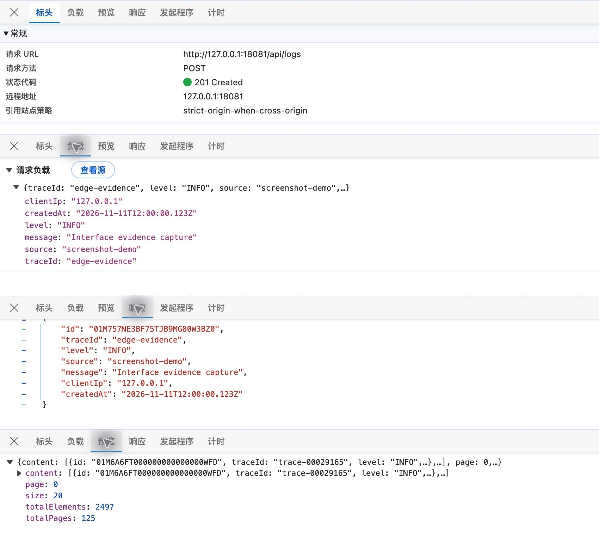

### MongoDB接口验收

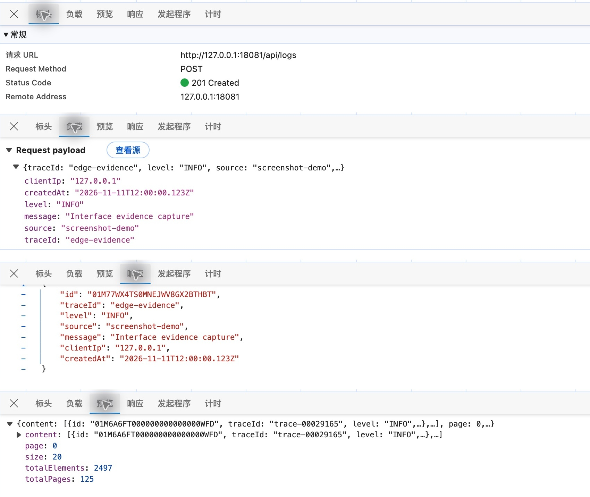

## 3.5　数据库记录与索引

MySQL记录图拍摄于2026年11月11日，记录数为765119条。MongoDB记录图拍摄于11月12日MongoRepository重跑后，末次写入后为776259条，接口演示新增1条，截图总数为776260条。MySQL宽表按列分为上下两块，行序保持一致。

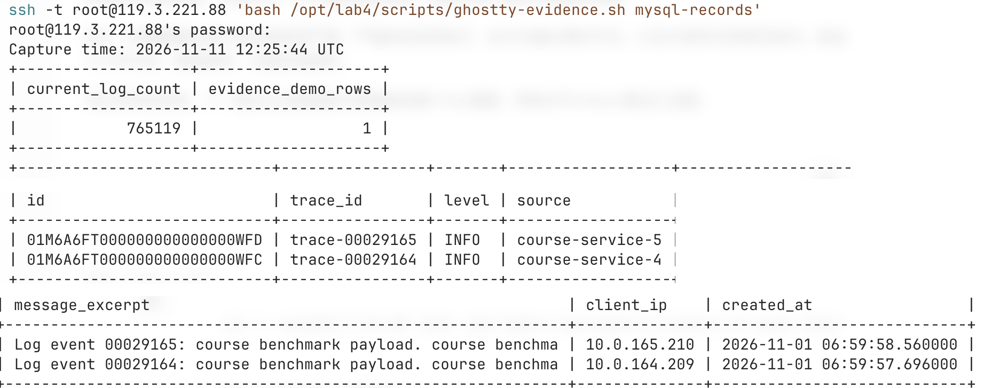

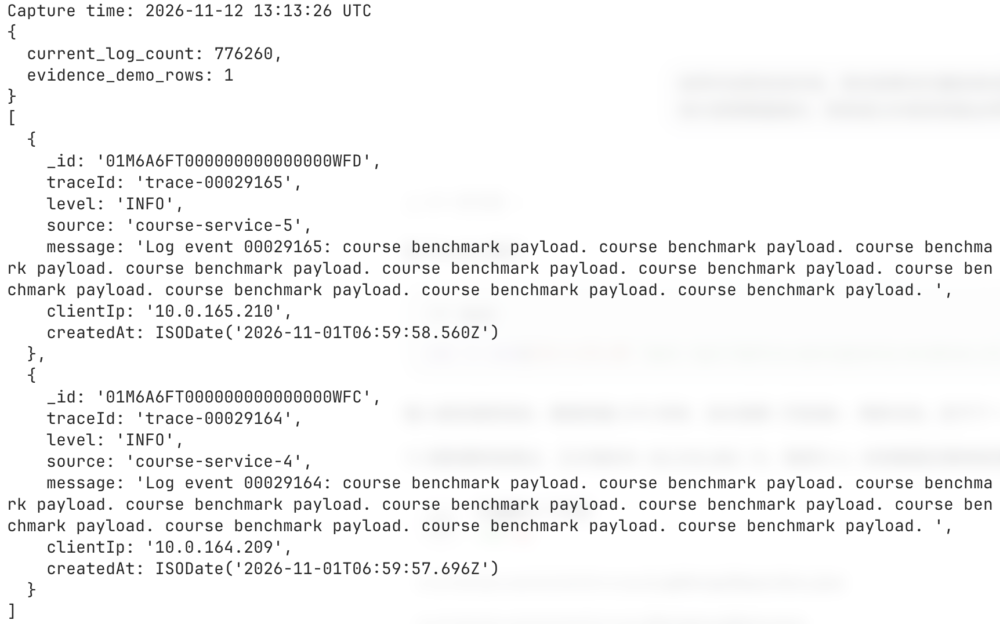

### 联合索引与执行计划

MySQL联合索引列为level、created_at、id，执行计划使用range访问和Using index condition，估计扫描2497行。MongoDB联合索引列为level、createdAt、_id，计划为LIMIT→FETCH→IXSCAN；执行统计显示返回20条、检查20个索引键和20个文档。图7左侧为索引与扫描阶段，右侧接续索引属性、边界和执行统计。

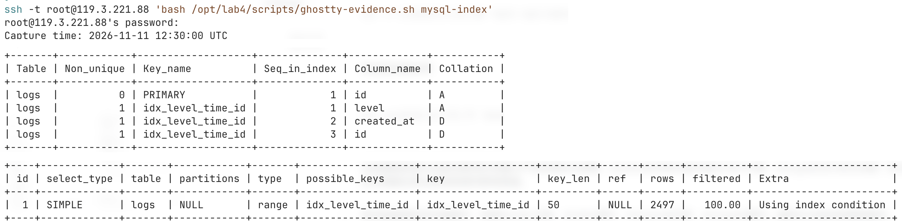

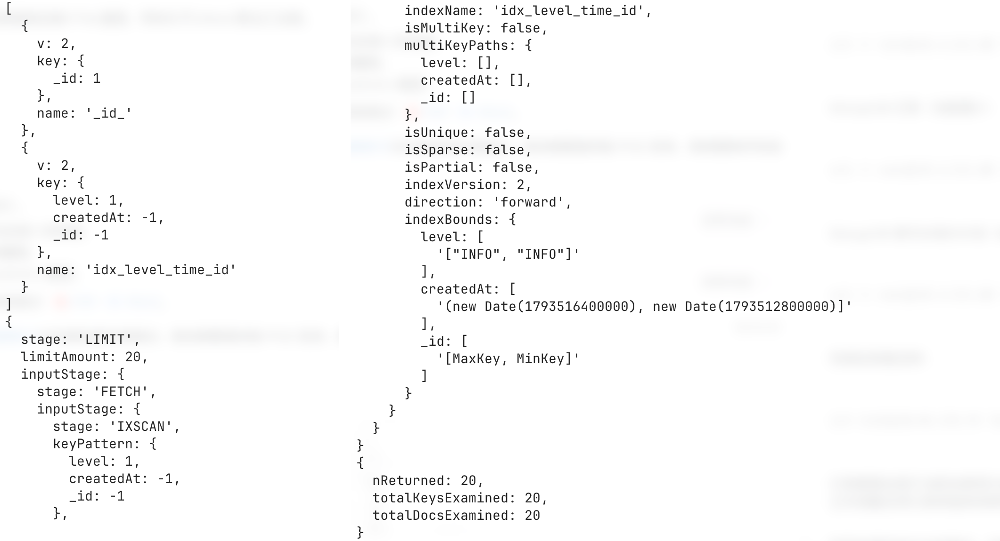

# 4　负载测试结果与分析

本章先比较1和10线程下的基础负载表现。每档3次测量，表中列出中位数；各次吞吐量、平均值、P50/P95/P99和错误率见results/all-runs.csv。两类操作分别使用相同请求与数据库初始数据。

## 4.1　查询负载测试

表3　查询基础负载性能

| 线程 | MySQL
次/秒 | P95
ms | P99
ms | MongoDB
次/秒 | P95
ms | P99
ms |
| --- | --- | --- | --- | --- | --- | --- |
| 1 | 373.3 | 3.0 | 4.0 | 414.3 | 3.0 | 4.0 |
| 10 | 1198.1 | 12.0 | 15.0 | 1242.8 | 13.0 | 16.0 |

10线程时，MySQL吞吐量为1,198.1次/秒、P95为12.0 ms；MongoDB为1,242.8次/秒、13.0 ms。两库1与10线程各3次正式测量的错误率均为0%。

1线程下，MySQL的P50/P95/P99中位数为3.0/3.0/4.0 ms；MongoDB为2.0/3.0/4.0 ms。下图为该档第1次重复的JMeter报告页面裁切图，左侧为5秒窗口的响应时间趋势，右侧为完整正式窗口的百分位分布。

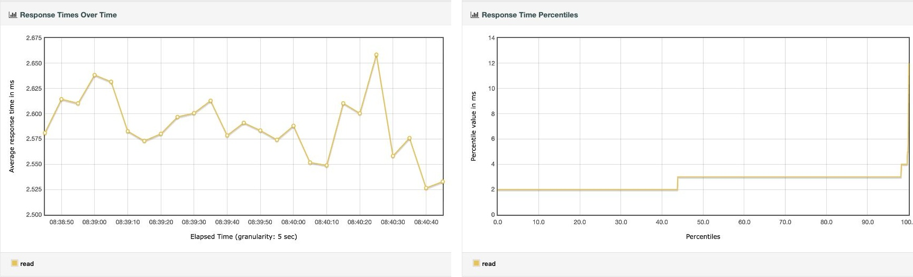

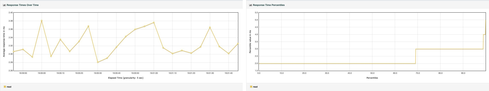

基础负载下的曲线用于观察短时波动与响应时间分布；后续压力测试使用全部并发档位，比较增加线程后的吞吐收益与延迟代价。

## 4.2　写入负载测试

表4　写入基础负载性能

| 线程 | MySQL
次/秒 | P95
ms | P99
ms | MongoDB
次/秒 | P95
ms | P99
ms |
| --- | --- | --- | --- | --- | --- | --- |
| 1 | 608.6 | 2.0 | 3.0 | 681.6 | 3.0 | 3.0 |
| 10 | 3909.9 | 4.0 | 5.0 | 3199.3 | 5.0 | 6.0 |

10线程时，MySQL吞吐量为3,909.9次/秒、P95为4.0 ms；MongoDB为3,199.3次/秒、5.0 ms。两库1与10线程各3次正式测量的错误率均为0%。

1线程下，MySQL的P50/P95/P99中位数为2.0/2.0/3.0 ms；MongoDB为1.0/3.0/3.0 ms。下图为该档第1次重复的JMeter报告页面裁切图，左侧为5秒窗口的响应时间趋势，右侧为完整正式窗口的百分位分布。

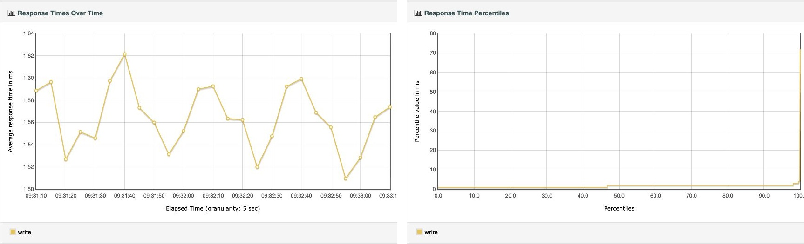

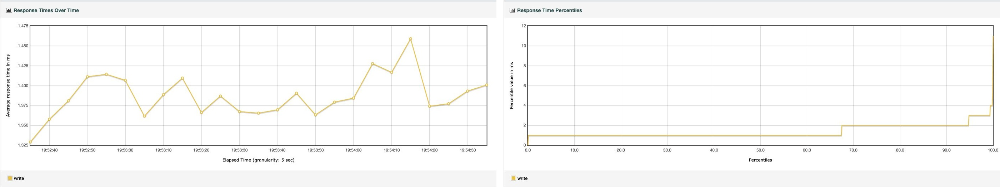

基础负载下的曲线用于观察短时波动与响应时间分布；后续压力测试使用全部并发档位，比较增加线程后的吞吐收益与延迟代价。

# 5　逐级压力测试结果与分析

本章比较1至200线程的阶梯升压结果。判断性能转折时同时检查吞吐量、延迟和错误率：增加线程后吞吐量趋平或回落、P95/P99继续上升，表明额外并发主要增加了等待。全部档位均完成，正式请求错误数为0；以下结论对应已测范围内的吞吐平台与延迟退化，故障上限和过载恢复未纳入本次测量。

## 5.1　查询阶梯升压

表5　查询逐级压力测试性能

| 线程 | MySQL
次/秒 | P95
ms | P99
ms | MongoDB
次/秒 | P95
ms | P99
ms |
| --- | --- | --- | --- | --- | --- | --- |
| 1 | 373.3 | 3.0 | 4.0 | 414.3 | 3.0 | 4.0 |
| 10 | 1198.1 | 12.0 | 15.0 | 1242.8 | 13.0 | 16.0 |
| 25 | 1304.7 | 30.0 | 36.0 | 1250.3 | 33.0 | 39.0 |
| 50 | 1307.4 | 73.0 | 109.0 | 1271.7 | 59.0 | 70.0 |
| 100 | 1285.8 | 145.0 | 210.0 | 1203.4 | 132.0 | 166.0 |
| 200 | 1258.0 | 305.0 | 444.0 | 1119.7 | 280.0 | 351.0 |

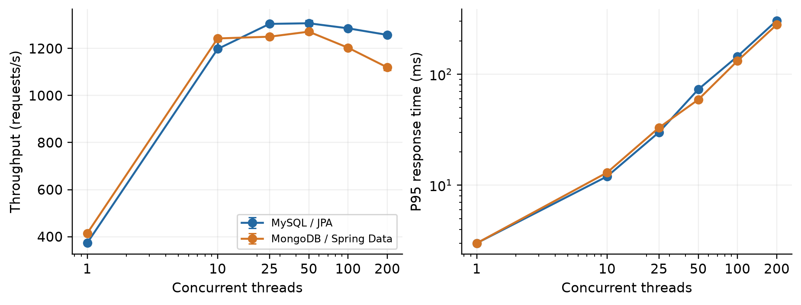

在已测档位中，MySQL最高中位吞吐量为1,307.4次/秒，对应50线程、P95为73.0 ms；MongoDB最高中位吞吐量为1,271.7次/秒，对应50线程、P95为59.0 ms。

MySQL从50线程增加到200线程，吞吐量较已测峰值下降3.8%，P95由73.0 ms上升至305.0 ms，约为4.2倍。此区间继续增加并发的主要代价是延迟增长。

MongoDB从50线程增加到200线程，吞吐量较已测峰值下降11.9%，P95由59.0 ms上升至280.0 ms，约为4.7倍。此区间继续增加并发的主要代价是延迟增长。

在200线程档，MongoDB相对MySQL的吞吐量低11.0%、P95低8.2%。

### 查询25线程的JMeter曲线

25线程下，MySQL的P50/P95/P99中位数为18.0/30.0/36.0 ms；MongoDB为20.0/33.0/39.0 ms。下图为该档第1次重复的JMeter报告页面裁切图，左侧为5秒窗口的响应时间趋势，右侧为完整正式窗口的百分位分布。

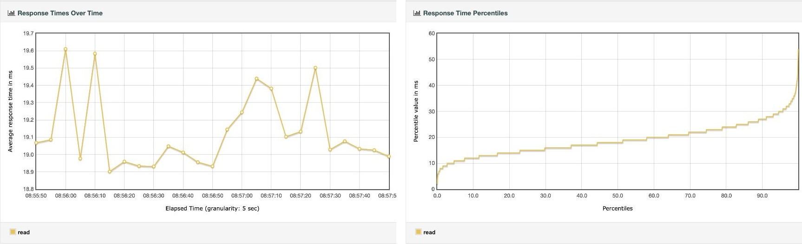

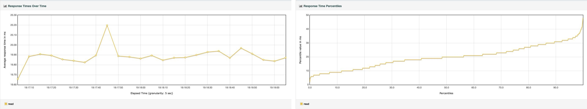

该档用于展示查询的性能转折附近状态。MySQL与MongoDB各自的已测峰值线程数见前表；两图采用相同并发，便于直接比较。

### 查询200线程的JMeter曲线

200线程下，MySQL的P50/P95/P99中位数为158.0/305.0/444.0 ms；MongoDB为175.0/280.0/351.0 ms。下图为该档第1次重复的JMeter报告页面裁切图，左侧为5秒窗口的响应时间趋势，右侧为完整正式窗口的百分位分布。

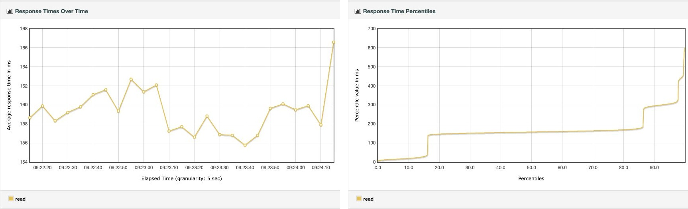

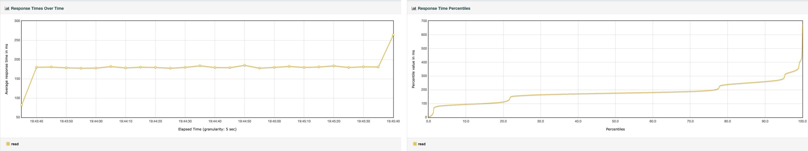

200线程时，MySQL的吞吐量为1,258.0次/秒、P95为305.0 ms；MongoDB的吞吐量为1,119.7次/秒、P95为280.0 ms。200线程为本次最高测试档位，三次测量均完成且错误率为0%。

### 查询压力下的资源表现

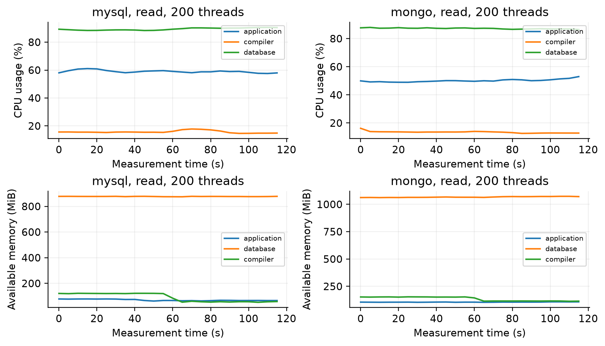

按压测机、应用机、数据库机顺序，平均CPU使用率为：MySQL为15.7%/59.0%/89.4%（压测机最小可用内存52.4 MiB）；MongoDB为13.5%/50.1%/87.2%（压测机最小可用内存113.8 MiB）。资源序列与延迟曲线使用同一正式窗口。

CPU占用最高的环节分别为MySQL的数据库机（89.4%）、MongoDB的数据库机（87.2%）。两库查询的数据库CPU均高于应用机和压测机，与吞吐平台及延迟增长同时出现。

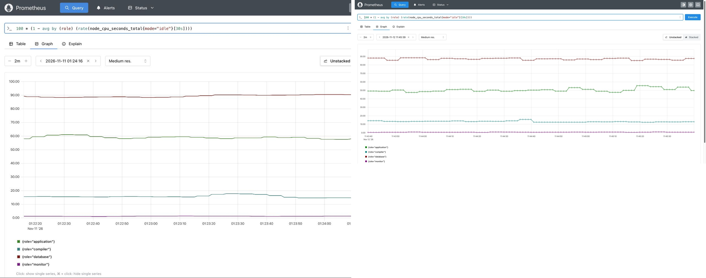

## 5.2　写入阶梯升压

表6　写入逐级压力测试性能

| 线程 | MySQL
次/秒 | P95
ms | P99
ms | MongoDB
次/秒 | P95
ms | P99
ms |
| --- | --- | --- | --- | --- | --- | --- |
| 1 | 608.6 | 2.0 | 3.0 | 681.6 | 3.0 | 3.0 |
| 10 | 3909.9 | 4.0 | 5.0 | 3199.3 | 5.0 | 6.0 |
| 25 | 4556.2 | 10.0 | 14.0 | 4506.9 | 9.0 | 11.0 |
| 50 | 5136.9 | 22.0 | 32.0 | 4396.4 | 19.0 | 23.0 |
| 100 | 4117.8 | 63.0 | 108.0 | 4303.0 | 44.0 | 60.0 |
| 200 | 4608.5 | 123.0 | 200.0 | 4142.7 | 95.0 | 136.0 |

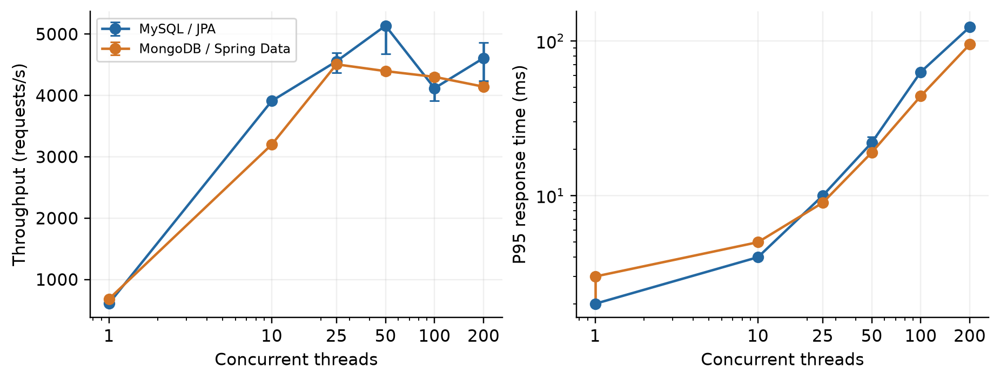

在已测档位中，MySQL最高中位吞吐量为5,136.9次/秒，对应50线程、P95为22.0 ms；MongoDB最高中位吞吐量为4,506.9次/秒，对应25线程、P95为9.0 ms。

MySQL从50线程增加到200线程，吞吐量较已测峰值下降10.3%，P95由22.0 ms上升至123.0 ms，约为5.6倍。此区间继续增加并发的主要代价是延迟增长。

MongoDB从25线程增加到200线程，吞吐量较已测峰值下降8.1%，P95由9.0 ms上升至95.0 ms，约为10.6倍。此区间继续增加并发的主要代价是延迟增长。

在200线程档，MongoDB相对MySQL的吞吐量低10.1%、P95低22.8%。

### 写入50线程的JMeter曲线

50线程下，MySQL的P50/P95/P99中位数为8.0/22.0/32.0 ms；MongoDB为11.0/19.0/23.0 ms。下图为该档第1次重复的JMeter报告页面裁切图，左侧为5秒窗口的响应时间趋势，右侧为完整正式窗口的百分位分布。

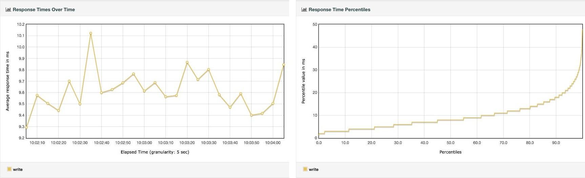

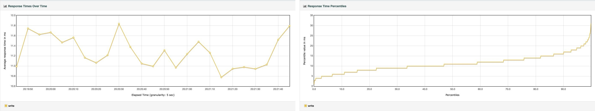

该档用于展示写入的性能转折附近状态。MySQL与MongoDB各自的已测峰值线程数见前表；两图采用相同并发，便于直接比较。

### 写入200线程的JMeter曲线

200线程下，MySQL的P50/P95/P99中位数为33.0/123.0/200.0 ms；MongoDB为47.0/95.0/136.0 ms。下图为该档第1次重复的JMeter报告页面裁切图，左侧为5秒窗口的响应时间趋势，右侧为完整正式窗口的百分位分布。

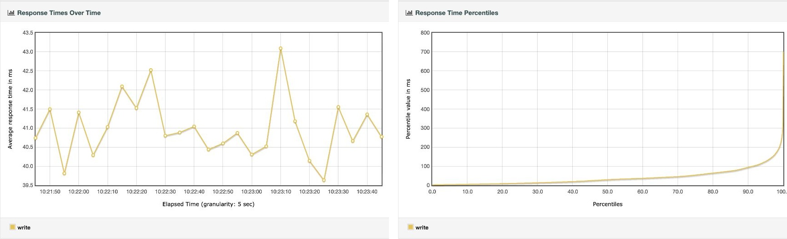

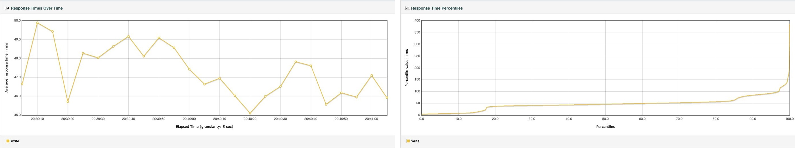

200线程时，MySQL的吞吐量为4,608.5次/秒、P95为123.0 ms；MongoDB的吞吐量为4,142.7次/秒、P95为95.0 ms。200线程为本次最高测试档位，三次测量均完成且错误率为0%。

### 写入压力下的资源表现

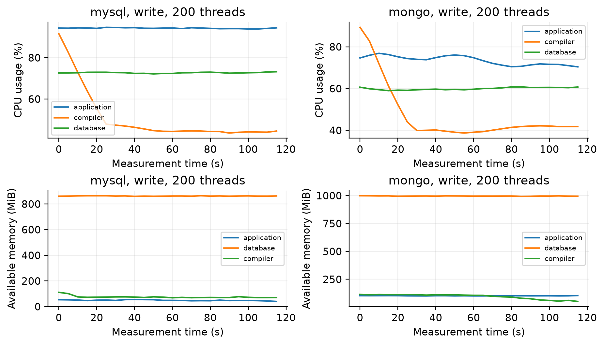

按压测机、应用机、数据库机顺序，平均CPU使用率为：MySQL为50.8%/94.3%/72.7%（压测机最小可用内存68.9 MiB）；MongoDB为47.2%/73.5%/60.0%（压测机最小可用内存51.2 MiB）。资源序列与延迟曲线使用同一正式窗口。

CPU占用最高的环节分别为MySQL的应用机（94.3%）、MongoDB的应用机（73.5%）。查询的高资源占用集中在数据库机，写入集中在应用机。该结果定位了当前链路的资源压力，具体等待原因还需结合数据库与应用剖析。

## 5.3　查询的JMeter原生汇总

下图展示200线程第1次重复的APDEX表、Requests Summary饼图和Statistics表，均裁切自JMeter原生报告页面。低负载和转折附近的同类原图同时保存在screenshots目录。APDEX阈值为T=500 ms、F=1500 ms；饼图的PASS表示HTTP请求与断言通过，响应时间分布由APDEX及百分位指标描述。

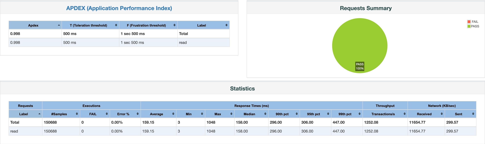

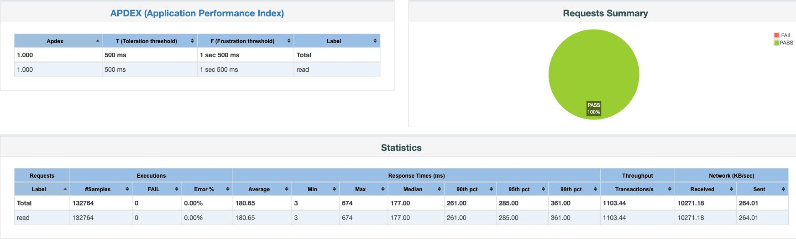

Statistics使用单次运行样本及其实际起止时刻计算吞吐量；正文对照表采用固定120秒窗口的每次请求数，再取3次中位数。两种统计口径对应的原始样本与重复编号均可在仓库中核对。

## 5.4　写入的JMeter原生汇总

下图展示200线程第1次重复的APDEX表、Requests Summary饼图和Statistics表，均裁切自JMeter原生报告页面。低负载和转折附近的同类原图同时保存在screenshots目录。APDEX阈值为T=500 ms、F=1500 ms；饼图的PASS表示HTTP请求与断言通过，响应时间分布由APDEX及百分位指标描述。

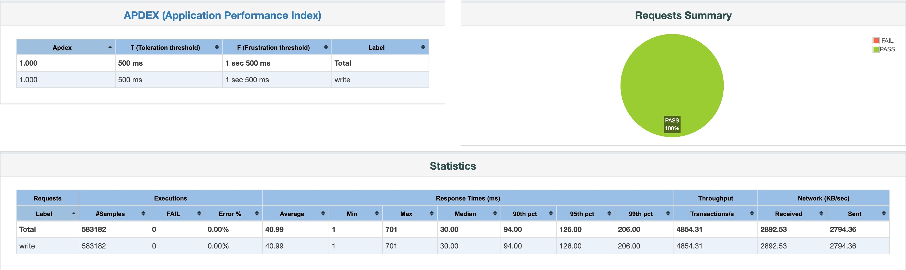

Statistics使用单次运行样本及其实际起止时刻计算吞吐量；正文对照表采用固定120秒窗口的每次请求数，再取3次中位数。两种统计口径对应的原始样本与重复编号均可在仓库中核对。

# 6　总结

本实验完成了同一日志模型和接口下的JPA/MySQL与Spring Data MongoDB/MongoDB对照实现，并在四台云主机上通过两轮部署完成72次正式测量。200线程时，MySQL的吞吐量为1,258.0次/秒、P95为305.0 ms；MongoDB的吞吐量为1,119.7次/秒、P95为280.0 ms。200线程时，MySQL的吞吐量为4,608.5次/秒、P95为123.0 ms；MongoDB的吞吐量为4,142.7次/秒、P95为95.0 ms。这些结果描述了本实验硬件、查询选择率、索引、连接池和写入确认设置下的应用链路表现。

查询返回20条数据并计算2497条匹配记录的总数，写入采用单条持久化并等待确认；两类操作承担不同的数据库工作。并发增加后的性能变化应结合吞吐量、P95/P99和主机资源判断。本文保留重复测量范围、原始错误和资源序列，使读写差异及性能转折均可追溯到具体运行。

表7　实验完成与数据核验

| 核验项目 | 结果 |
| --- | --- |
| 正式测量 | 72次，24个实现与操作并发组合，各重复3次 |
| 正式请求数 | 20,576,002 |
| 正式错误数 | 0 |
| 记录数核对 | 全部运行均完成核对 |
| 原始数据 | 升压预热、正式窗口、收尾JTL无损压缩及SHA-256 |
| 程序与材料 | https://github.com/Baakarshan/mysql-mongodb-log-lab4 |

## 参考文献

[1] Spring. Spring Data JPA Reference Documentation. https://docs.spring.io/spring-data/jpa/reference/.

[2] Spring. Spring Data MongoDB Reference Documentation. https://docs.spring.io/spring-data/mongodb/reference/.

[3] Apache Software Foundation. Apache JMeter User Manual: Generating Dashboard Report. https://jmeter.apache.org/usermanual/generating-dashboard.html.

[4] MongoDB. Write Concern. https://www.mongodb.com/docs/v7.0/reference/write-concern/.

[5] Oracle. MySQL 8.4 Reference Manual: InnoDB Startup Options and System Variables. https://dev.mysql.com/doc/refman/8.4/en/innodb-parameters.html.

[6] mingqcn. spring-fundamentals: 6.SpringData_Mongo/order. https://gitee.com/mingqcn/spring-fundamentals. 核对版本854d0e09，2026-11-12.
