MySQL 与 MongoDB 日志读写性能对比

温子健

摘　要：本文以平均响应时间为主指标，比较Spring Data JPA/MySQL与Spring Data MongoDB/MongoDB的日志读写性能。四台服务器分两轮复用，Manager使用JMeter发压，每个线程只执行一次HTTP请求，在固定35秒内逐个启动线程，逐级增加线程总数。每档恢复10万条初始数据，以中间20秒的完整秒计数检查发送均匀性。平均响应时间明显上升后，细分相邻档位并检查CPU、内存、磁盘、GC、连接池等待与线程状态。两库共同正常查询档位25200线程下，平均响应分别为4.22与3.52 ms。两库共同正常写入档位37800线程下，平均响应分别为2.22与2.36 ms。共完成47次运行，正式窗口记录617,360次请求。逐次JTL、原生JMeter页面及Prometheus资源记录共同支持负载转折和参数对照分析。

关键词：MySQL；MongoDB；平均响应时间；负载测试；JMeter；Prometheus

Log Read and Write Performance of MySQL and MongoDB

CHIKIN WEN

Abstract: This experiment compares JPA/MySQL and Spring Data MongoDB using mean HTTP response time as the primary metric. Four servers are reused in two rounds. JMeter on Manager starts each thread once within a fixed 35-second ramp, and each thread sends one request. Total thread counts increase progressively. Each run resets 100,000 logs and measures the middle 20 seconds. Per-second starts verify traffic uniformity. A marked rise in mean response time triggers finer testing and inspection of CPU, memory, disk activity, GC, connection-pool waits and thread states. At the common normal read load of 25,200 threads, mean response times were 4.22 ms for MySQL and 3.52 ms for MongoDB. At the common normal write load of 37,800 threads, mean response times were 2.22 ms for MySQL and 2.36 ms for MongoDB. The 47 runs contain 617,360 measured requests. Native JMeter reports and Prometheus records support the load and parameter analysis.

Key words: MySQL; MongoDB; mean response time; load testing; JMeter; Prometheus

# 1　问题描述

日志服务写入单条事件，并按级别与时间分页查询。实验首先逐级增加线程数，观察平均响应时间与资源占用的变化；响应明显变慢后进入压力分析，检查资源饱和、排队与配置的关系。吞吐量、错误率和响应时间分位数作为辅助指标。

# 2　实验环境与实现

表1　四台机器分两轮复用

| 主机 | 配置 | 任务 |
| --- | --- | --- |
| Compiler | 2核，792 MiB | Java 17、Maven构建 |
| Node1 | 2核，1800 MiB | MySQL 8.4.13 / MongoDB 7.0.16 |
| Node2 | 2核，792 MiB | Spring Boot 3.3.13，堆256 MiB |
| Manager | 2核，1800 MiB | JMeter 5.6.3发压、Prometheus 3.7.3 |

第一轮运行MySQL与JPA实现，第二轮运行MongoDB与Spring Data MongoDB实现。数据库和应用各占一台机器，Manager全程发压并采集监控，Compiler负责构建。两轮使用同一应用JAR。数据库缓存约256 MiB、容器上限1 GiB；应用堆256 MiB、容器上限560 MiB，基础连接池20。MySQL每次提交刷盘并关闭binlog；MongoDB单机w=1、journal=true。压测期间暂停共用资源的四项RBAC服务，结束后恢复原副本数。

公共字段为id、traceId、level、source、message、clientIp、createdAt；服务端生成26位ULID，UTC时间精确到毫秒，正文最多4096字符。POST返回201与保存对象；GET使用[from,to)时间范围、从0开始分页，按createdAt、id降序，返回当前页和匹配总数。两库建立level、createdAt、id联合索引。Java代码按Google Java Style排版，中文注释说明查询与字段语义。

# 3　实验设计

## 3.1　每线程一次请求与均匀启动

JMeter使用5个相同的普通线程组平分线程总数，各组的循环次数固定为1，调度器关闭，Ramp-up固定35秒，启用delayedStart以在需要时创建线程。每档只增加线程总数，读写分别测试。线程总数除以35给出计划平均启动率，实际启动数以JTL时间戳核对。线程总数表示整档累计启动的线程数量，同时活跃线程数由响应时间决定，两者分别记录。

每档前恢复10万条固定种子日志，前10秒用于应用与JMeter预热，正式窗口取时钟起点后10至30秒；最后5秒保持发送，以避开结束边界。窗口内按相对起点切分20个完整秒。HPS最大/最小比达到2或出现零启动秒时，该档不满足发送均匀性要求；线程缺失、发压器异常或实际速率明显偏离计划也单列为发压限制。原生页面采用墙钟整秒分箱，图首尾的不足一秒分箱与完整秒核验值分别解释。JMeter页面展示北京时间，Prometheus页面展示UTC；逐次记录使用Unix毫秒时间对应两者。

每个线程执行一个HTTP采样器，连接超时2秒、响应超时5秒，关闭HTTP客户端重试。原生JTL保留实际请求时间、完整响应耗时、状态码、错误和线程名；正式JTL按请求启动时刻划窗。平均响应时间为正式窗口全部HTTP样本耗时的算术平均值；失败样本耗时和成功样本均值分别保存，错误率随均值一起解释。吞吐量使用正式窗口请求数除以20秒。

查询固定INFO级别、2026年11月1日UTC 06:00至07:00、第一页20条，种子数据匹配2497条；写入使用相同字段与固定正文规则。两轮保持机器、请求、启动时间、超时和采样周期一致。JMeter堆384 MiB、线程栈256 KiB。

## 3.2　逐级增加与转折排查

从2800个线程开始，在相同启动时间内提高线程总数。响应仍快且无错时继续增加；平均响应超过基线10倍且达到50毫秒，或错误率超过1%时，进入转折排查。该判据用于选择细分与诊断档，最终转折结合整条均值曲线、错误和资源判断。转折前后增加中间线程档，复测原转折档，再将连接池从20改为40作单参数对照，最后恢复连接池20并检查低负载。

Prometheus每5秒采集主机与应用指标。Manager主机CPU包含JMeter和Prometheus，发压JVM的CPU、RSS与线程数另外按秒记录。检查整机及逐核CPU、负载均值、I/O等待、磁盘忙碌、可用内存、JVM堆、GC、活跃线程和文件描述符；MySQL另外检查Hikari活跃连接及等待。诊断档采集应用线程栈与数据库状态。CPU未满时，按这些证据检查资源等待和参数；CPU均值与某个资源是否饱和分别判断。

预试验发现，未启用delayedStart时JMeter提前创建大量等待线程，5600线程档出现pthread_create EAGAIN，实际请求数量少于配置线程数。启用按需创建并将线程均分到5组后重新执行正式测试；预试验日志与参数修正保存在evidence/generator-preflight，正式结果按新的JMX重新采集。

## 3.3　接口与部署核验

MySQL通过14项接口检查，覆盖状态码、字段、排序、分页、空结果、非法级别、超长正文和毫秒时间边界。

MongoDB通过14项接口检查，覆盖状态码、字段、排序、分页、空结果、非法级别、超长正文和毫秒时间边界。

# 4　负载测试

本节展示逐级探索中的正常负载和首次响应转折。图中叉号表示发送条件不合格，折线连接均匀发送的档位。主表先列平均响应时间，再列实际发送率、错误率与HPS范围；资源表用于观察随线程数增加的内部变化。每次运行独立恢复数据，正式窗口均为20秒。

## 4.1　查询负载

表2　查询逐级负载结果

| 实现 | 线程总数 | 平均ms | 实际HPS | 错误率 | HPS最小–最大 | 最大/最小 |
| --- | --- | --- | --- | --- | --- | --- |
| MySQL | 2800 | 5.15 | 80.0 | 0.0% | 80–80 | 1.000 |
| MySQL | 5600 | 3.52 | 160.2 | 0.0% | 159–161 | 1.013 |
| MySQL | 11200 | 3.29 | 323.9 | 0.0% | 321–329 | 1.025 |
| MySQL | 16800 | 3.33 | 492.7 | 0.0% | 464–534 | 1.151 |
| MySQL | 25200 | 4.22 | 749.5 | 0.0% | 678–875 | 1.291 |
| MySQL | 37800 | 719.20 | 1,030.8 | 18.0% | 701–1342 | 1.914 |
| MongoDB | 2800 | 4.06 | 80.0 | 0.0% | 80–80 | 1.000 |
| MongoDB | 5600 | 3.17 | 160.0 | 0.0% | 158–161 | 1.019 |
| MongoDB | 11200 | 2.82 | 322.6 | 0.0% | 321–324 | 1.009 |
| MongoDB | 16800 | 2.96 | 490.6 | 0.0% | 470–535 | 1.138 |
| MongoDB | 25200 | 3.52 | 744.3 | 0.0% | 658–873 | 1.327 |
| MongoDB | 37800 | 345.13 | 1,064.5 | 0.0% | 910–1383 | 1.520 |

MySQL查询首次逐级探索中，25200线程档平均响应时间为4.22 ms，实际启动749.55次/秒，错误率0.00%，完整秒HPS为678至875。

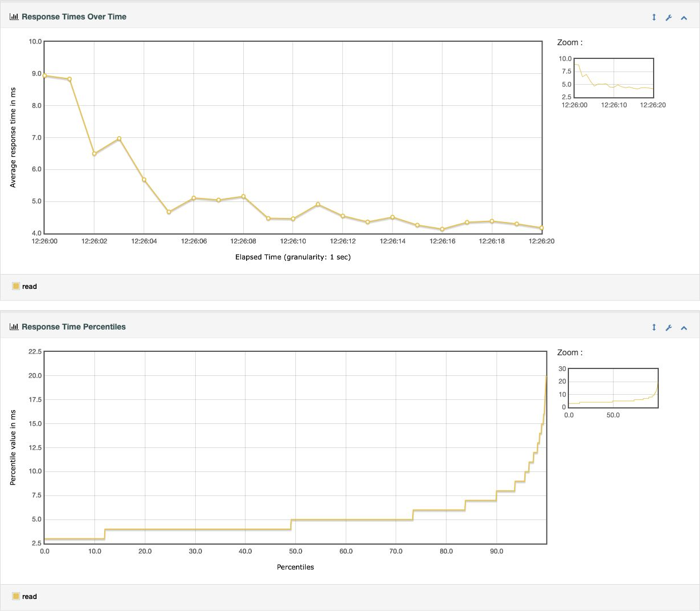

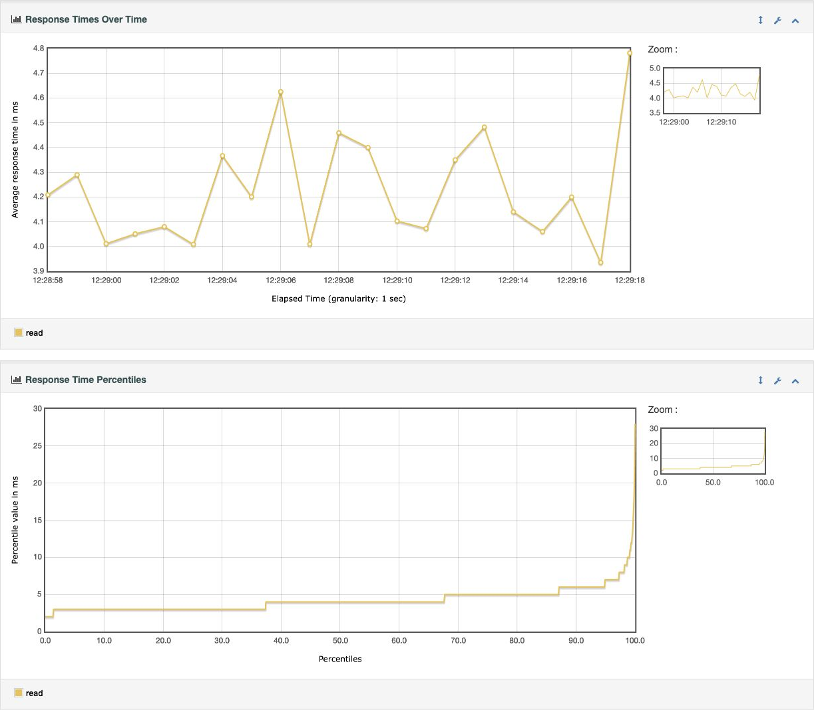

MongoDB查询首次逐级探索中，25200线程档平均响应时间为3.52 ms，实际启动744.30次/秒，错误率0.00%，完整秒HPS为658至873。

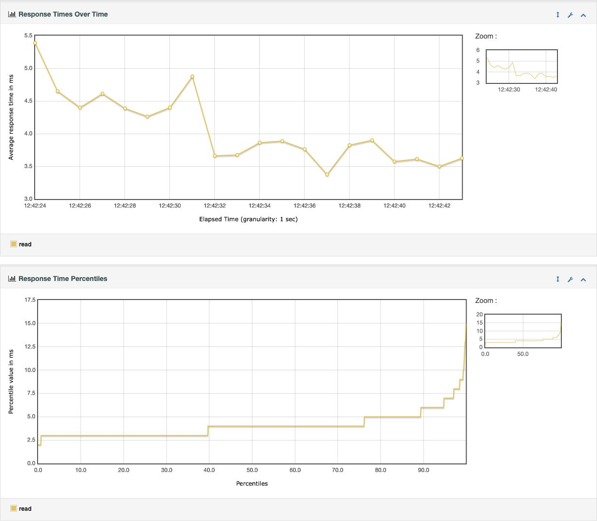

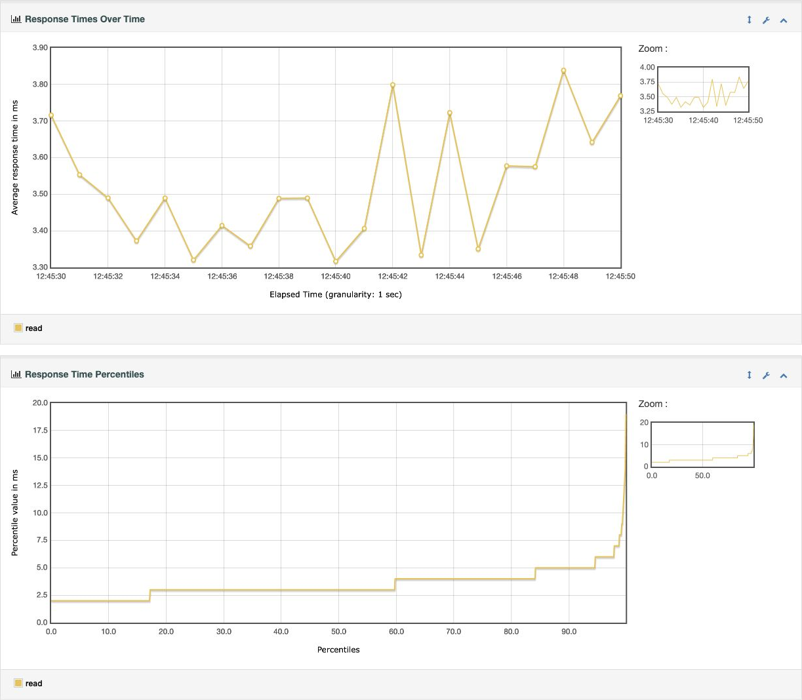

## 4.2　写入负载

表3　写入逐级负载结果

| 实现 | 线程总数 | 平均ms | 实际HPS | 错误率 | HPS最小–最大 | 最大/最小 |
| --- | --- | --- | --- | --- | --- | --- |
| MySQL | 2800 | 2.83 | 80.0 | 0.0% | 79–81 | 1.025 |
| MySQL | 5600 | 2.26 | 160.2 | 0.0% | 159–161 | 1.013 |
| MySQL | 11200 | 1.99 | 323.1 | 0.0% | 320–328 | 1.025 |
| MySQL | 16800 | 2.03 | 488.9 | 0.0% | 474–529 | 1.116 |
| MySQL | 25200 | 2.11 | 751.6 | 0.0% | 699–806 | 1.153 |
| MySQL | 37800 | 2.22 | 1,135.3 | 0.0% | 901–1494 | 1.658 |
| MySQL | 56700 | 2.56 | 1,757.5 | 0.0% | 967–2152 | 2.225 |
| MongoDB | 2800 | 2.62 | 80.0 | 0.0% | 80–80 | 1.000 |
| MongoDB | 5600 | 1.97 | 160.2 | 0.0% | 159–161 | 1.013 |
| MongoDB | 11200 | 1.83 | 322.9 | 0.0% | 322–326 | 1.012 |
| MongoDB | 16800 | 1.92 | 490.0 | 0.0% | 470–530 | 1.128 |
| MongoDB | 25200 | 2.09 | 750.2 | 0.0% | 690–807 | 1.170 |
| MongoDB | 37800 | 2.36 | 1,142.5 | 0.0% | 882–1527 | 1.731 |
| MongoDB | 56700 | 2.92 | 1,735.5 | 0.0% | 1085–2134 | 1.967 |
| MongoDB | 85050 | 3.46 | 2,384.1 | 0.0% | 1331–2941 | 2.210 |

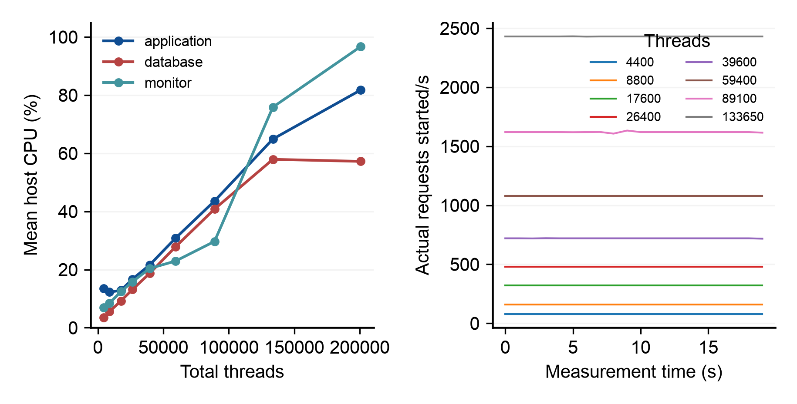

MySQL写入首次逐级探索中，37800线程档平均响应时间为2.22 ms，实际启动1135.30次/秒，错误率0.00%，完整秒HPS为901至1494。

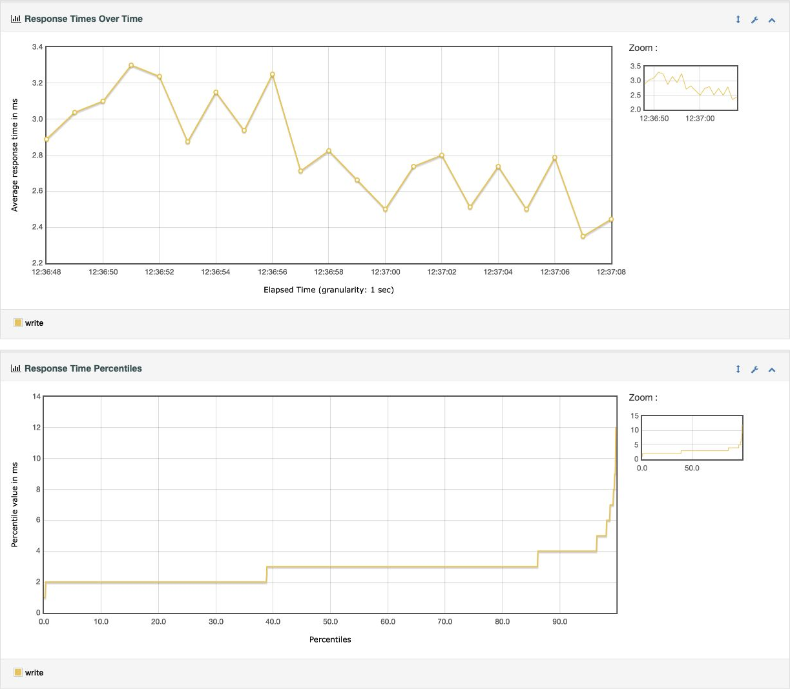

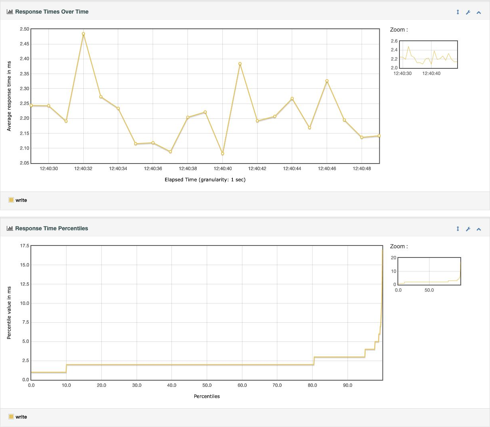

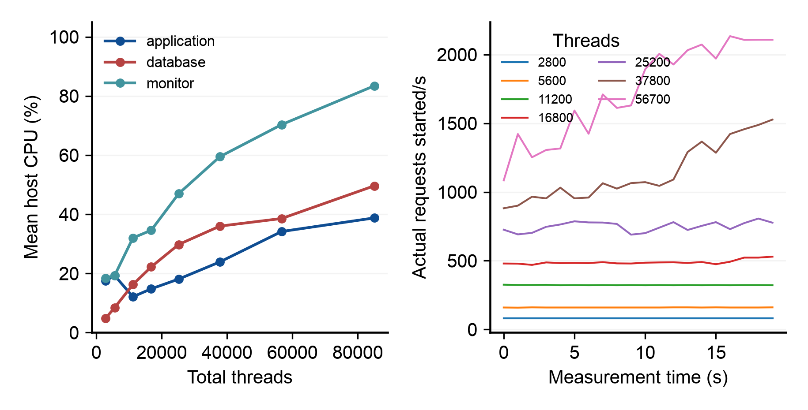

MongoDB写入首次逐级探索中，56700线程档平均响应时间为2.92 ms，实际启动1735.55次/秒，错误率0.00%，完整秒HPS为1085至2134。

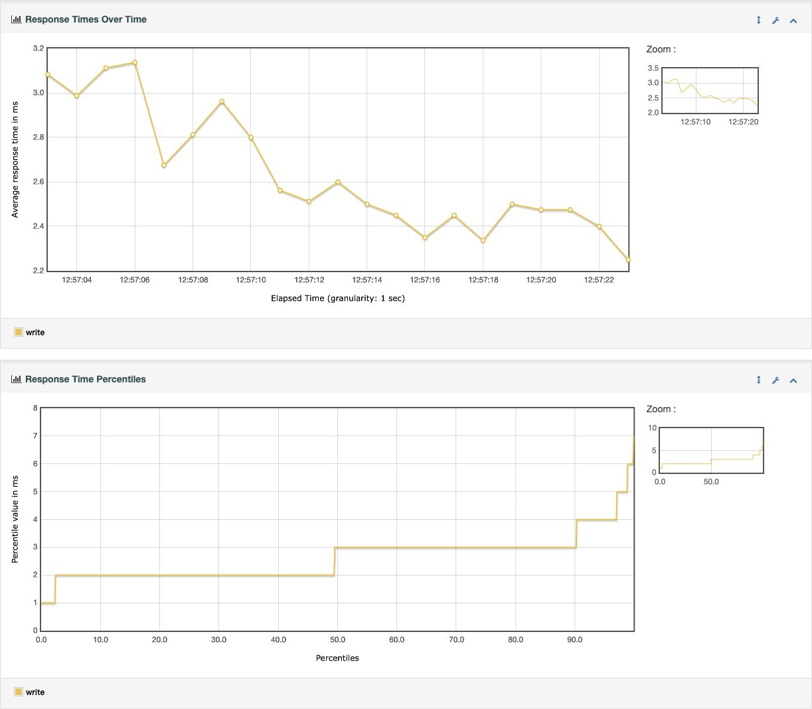

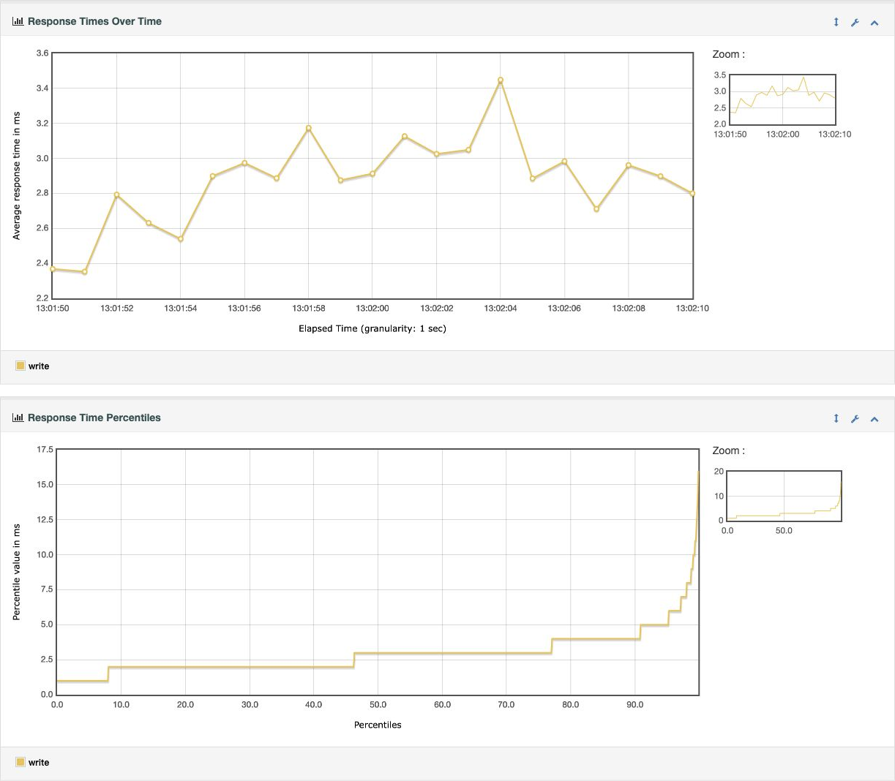

# 5　压力与转折分析

## 5.1　查询转折与参数对照

表4　查询细分、复测与恢复

| 实现 | 线程数 | 连接池 | 目的 | 平均ms | 错误率 |
| --- | --- | --- | --- | --- | --- |
| MySQL | 31500 | 20 | 转折细分 | 2038.12 | 100.0% |
| MySQL | 37800 | 20 | 转折复测 | 2156.35 | 100.0% |
| MySQL | 37800 | 40 | 连接池40对照 | 1108.52 | 97.1% |
| MySQL | 2800 | 20 | 恢复确认 | 5.81 | 0.0% |
| MongoDB | 31500 | 20 | 转折细分 | 2207.94 | 100.0% |
| MongoDB | 37800 | 20 | 转折复测 | 2069.83 | 93.7% |
| MongoDB | 37800 | 40 | 连接池40对照 | 2231.92 | 100.0% |
| MongoDB | 2800 | 20 | 恢复确认 | 3.93 | 0.0% |
| MySQL | 2800 | 20 | Tomcat40对照 | 5.20 | 0.0% |
| MySQL | 25200 | 20 | Tomcat40对照 | 4.72 | 0.0% |
| MySQL | 37800 | 20 | Tomcat40对照 | 171.00 | 0.0% |
| MongoDB | 2800 | 20 | Tomcat40对照 | 4.29 | 0.0% |
| MongoDB | 25200 | 20 | Tomcat40对照 | 3.87 | 0.0% |
| MongoDB | 37800 | 20 | Tomcat40对照 | 175.52 | 0.0% |

MySQL查询在37800线程档平均响应达到719.20 ms，前一档为4.22 ms；错误率17.95%。应用与数据库CPU均值分别为45.1%、70.5%，应用机最少可用内存124.9 MiB。

表5　MySQL查询资源与连接池等待

| 连接池/工作线程 | 平均ms | 应用CPU% | 逐核CPU峰值% | I/O等待峰值% | 连接等待峰值 |
| --- | --- | --- | --- | --- | --- |
| 20/200 | 2156.35 | 98.3 | 99.8 | 0.1 | 67.0 |
| 40/200 | 1108.52 | 92.3 | 99.6 | 0.0 | — |
| 20/40 | 5.20 | 49.8 | 81.4 | 0.0 | 0.0 |
| 20/40 | 4.72 | 66.9 | 78.6 | 0.1 | 0.0 |
| 20/40 | 171.00 | 56.1 | 65.4 | 0.1 | 0.0 |

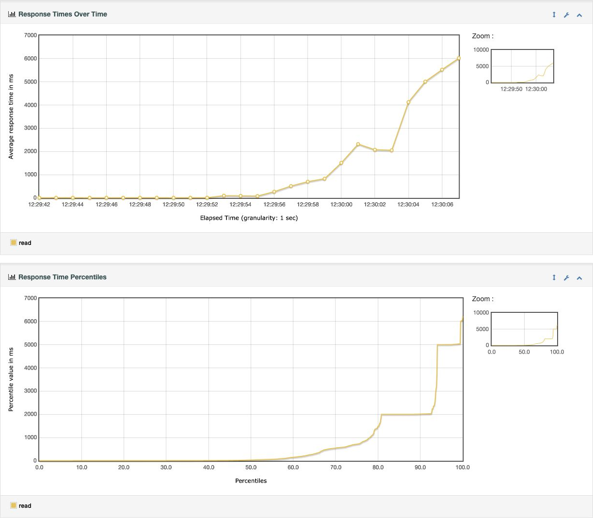

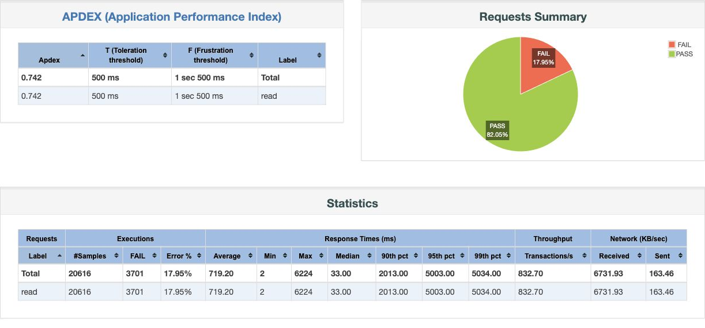

MongoDB查询在37800线程档平均响应达到345.13 ms，前一档为3.52 ms；错误率0.00%。应用与数据库CPU均值分别为37.4%、74.5%，应用机最少可用内存209.8 MiB。

表6　MongoDB查询资源与连接池等待

| 连接池/工作线程 | 平均ms | 应用CPU% | 逐核CPU峰值% | I/O等待峰值% | 连接等待峰值 |
| --- | --- | --- | --- | --- | --- |
| 20/200 | 2069.83 | 95.1 | 99.2 | 0.0 | 见线程栈 |
| 40/200 | 2231.92 | 98.0 | 99.6 | 0.1 | 见线程栈 |
| 20/40 | 4.29 | 38.2 | 70.2 | 0.1 | 见线程栈 |
| 20/40 | 3.87 | 55.5 | 72.2 | 0.1 | 见线程栈 |
| 20/40 | 175.52 | 44.7 | 55.4 | 0.0 | 见线程栈 |

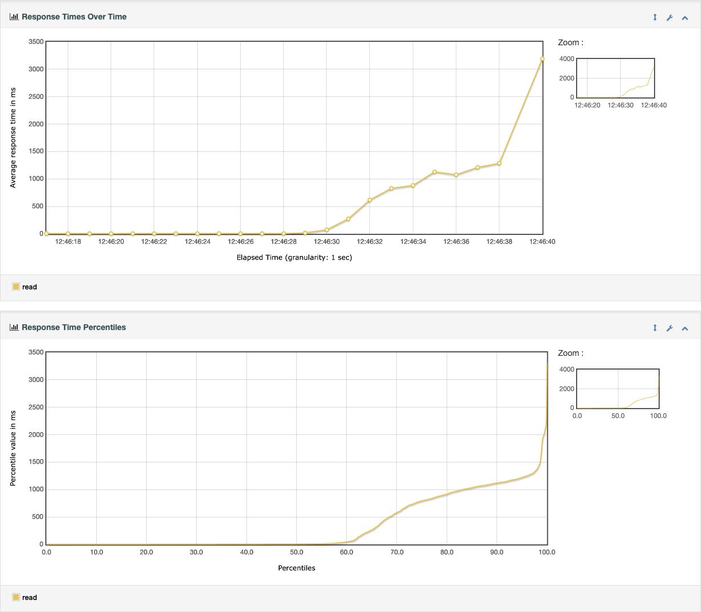

## 5.2　写入转折与参数对照

表7　写入细分、复测与恢复

| 实现 | 线程数 | 连接池 | 目的 | 平均ms | 错误率 |
| --- | --- | --- | --- | --- | --- |
| MySQL | 2800 | 20 | Tomcat40对照 | 3.35 | 0.0% |
| MySQL | 25200 | 20 | Tomcat40对照 | 2.46 | 0.0% |
| MySQL | 37800 | 20 | Tomcat40对照 | 2.30 | 0.0% |
| MongoDB | 2800 | 20 | Tomcat40对照 | 2.95 | 0.0% |
| MongoDB | 25200 | 20 | Tomcat40对照 | 2.21 | 0.0% |
| MongoDB | 37800 | 20 | Tomcat40对照 | 2.29 | 0.0% |

MySQL写入的56700线程档不满足发送条件：实际记录56700个HTTP请求，配置56700线程，完整秒HPS范围967至2152。该档保留用于排查发送条件，性能比较使用均匀发送的档位。该标记依据实际发送结果，故障来源再结合两端日志判断。

表8　MySQL写入资源与连接池等待

| 连接池/工作线程 | 平均ms | 应用CPU% | 逐核CPU峰值% | I/O等待峰值% | 连接等待峰值 |
| --- | --- | --- | --- | --- | --- |
| 20/40 | 3.35 | 22.2 | 35.6 | 3.3 | 0.0 |
| 20/40 | 2.46 | 47.6 | 59.0 | 17.2 | 0.0 |
| 20/40 | 2.30 | 27.4 | 31.6 | 19.8 | 0.0 |

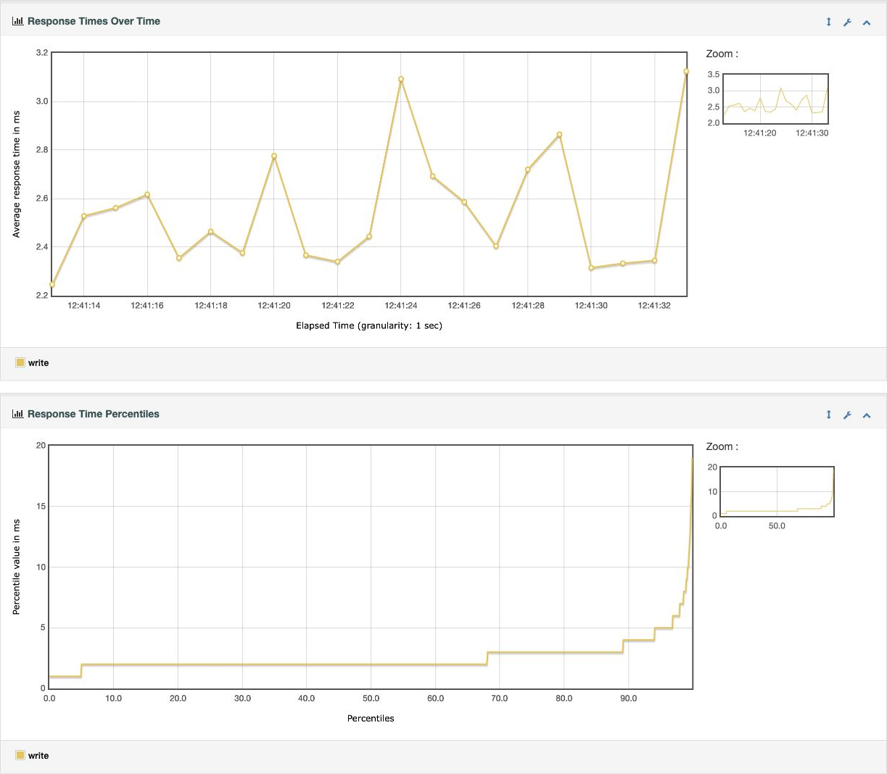

MongoDB写入的85050线程档不满足发送条件：实际记录85050个HTTP请求，配置85050线程，完整秒HPS范围1331至2941。该档保留用于排查发送条件，性能比较使用均匀发送的档位。该标记依据实际发送结果，故障来源再结合两端日志判断。

表9　MongoDB写入资源与连接池等待

| 连接池/工作线程 | 平均ms | 应用CPU% | 逐核CPU峰值% | I/O等待峰值% | 连接等待峰值 |
| --- | --- | --- | --- | --- | --- |
| 20/40 | 2.95 | 21.9 | 28.0 | 2.8 | 见线程栈 |
| 20/40 | 2.21 | 46.9 | 65.4 | 19.8 | 见线程栈 |
| 20/40 | 2.29 | 24.5 | 28.4 | 25.3 | 见线程栈 |

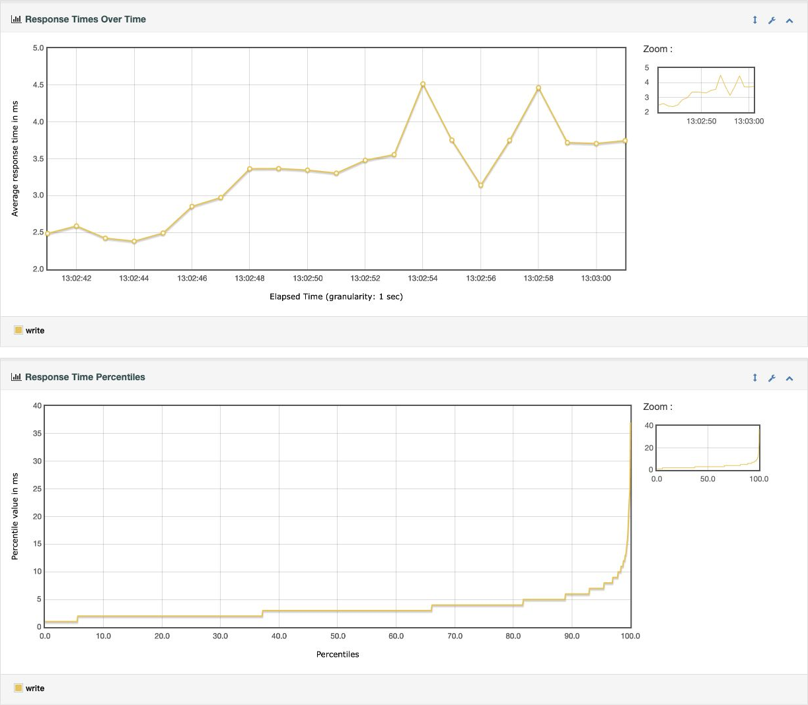

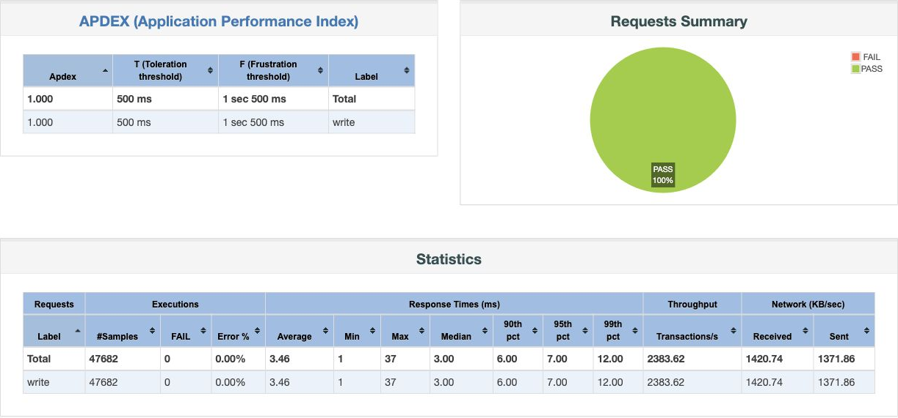

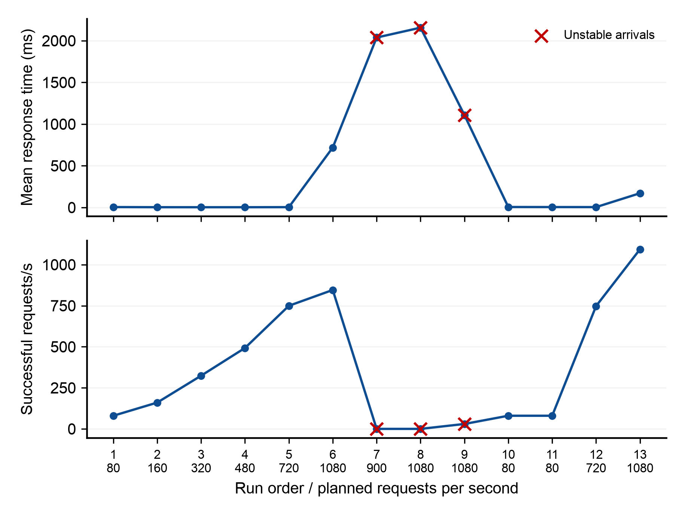

逐次运行图保留转折后的故障复现：MySQL查询细分档的成功吞吐降至0，MongoDB查询细分档也降至0；两者低负载恢复后重新成功响应。叉号对应发送不均匀的故障运行，其作用是呈现下降和恢复过程，数据库容量比较使用前节合格档位。横轴按该实现查询运行的时间顺序排列，下行数字为计划每秒启动数。

## 5.3　应用线程参数修正

MySQL查询首次转折运行中，应用Java线程数由64增至223，RSS由约276 MiB增至373 MiB；正式窗口结束后约15秒，内核杀死Java进程。连接池等待采样为0，扩大连接池后的运行仍严重退化。随后将Tomcat最大工作线程由默认200改为40，连接池保持20、JVM堆保持256 MiB，两库采用同一修正参数，分别检查低负载及720、1080次/秒附近的表现。

表10　Tomcat最大工作线程40的对照结果

| 实现/操作 | 线程总数 | 平均ms | 错误率 | HPS比 | 测后健康 |
| --- | --- | --- | --- | --- | --- |
| MySQL/查询 | 2800 | 5.20 | 0.0% | 1.0 | UP |
| MySQL/查询 | 25200 | 4.72 | 0.0% | 1.2 | UP |
| MySQL/查询 | 37800 | 171.00 | 0.0% | 1.5 | 未响应 |
| MySQL/写入 | 2800 | 3.35 | 0.0% | 1.0 | UP |
| MySQL/写入 | 25200 | 2.46 | 0.0% | 1.3 | UP |
| MySQL/写入 | 37800 | 2.30 | 0.0% | 1.9 | UP |
| MongoDB/查询 | 2800 | 4.29 | 0.0% | 1.0 | UP |
| MongoDB/查询 | 25200 | 3.87 | 0.0% | 1.4 | UP |
| MongoDB/查询 | 37800 | 175.52 | 0.0% | 1.6 | UP |
| MongoDB/写入 | 2800 | 2.95 | 0.0% | 1.0 | UP |
| MongoDB/写入 | 25200 | 2.21 | 0.0% | 1.4 | UP |
| MongoDB/写入 | 37800 | 2.29 | 0.0% | 1.8 | UP |

对照通过限制应用端同时处理的工作线程，检查小内存主机的内存与排队变化。每次对照的实际发送均匀性仍单独核对；HPS不合格的运行用于诊断。

MySQL查询在37800线程档，原配置平均719.20 ms、错误率17.95%；工作线程上限40的对照为171.00 ms、错误率0.00%。对照结束后的健康检查为未响应。

MongoDB查询在37800线程档，原配置平均345.13 ms、错误率0.00%；工作线程上限40的对照为175.52 ms、错误率0.00%。对照结束后的健康检查为UP。

线程上限40将应用工作线程数量约束在较小范围；正式窗口的Java总线程数、RSS、连接等待和网络数据用于检查这一变化。原配置探索与参数对照的前序压测历史不同，表中保留各次运行与测后健康状态。高负载下响应仍显著延长，较低工作线程上限改善了本次观察中的平均响应，持续过载仍需按压力状态处理。

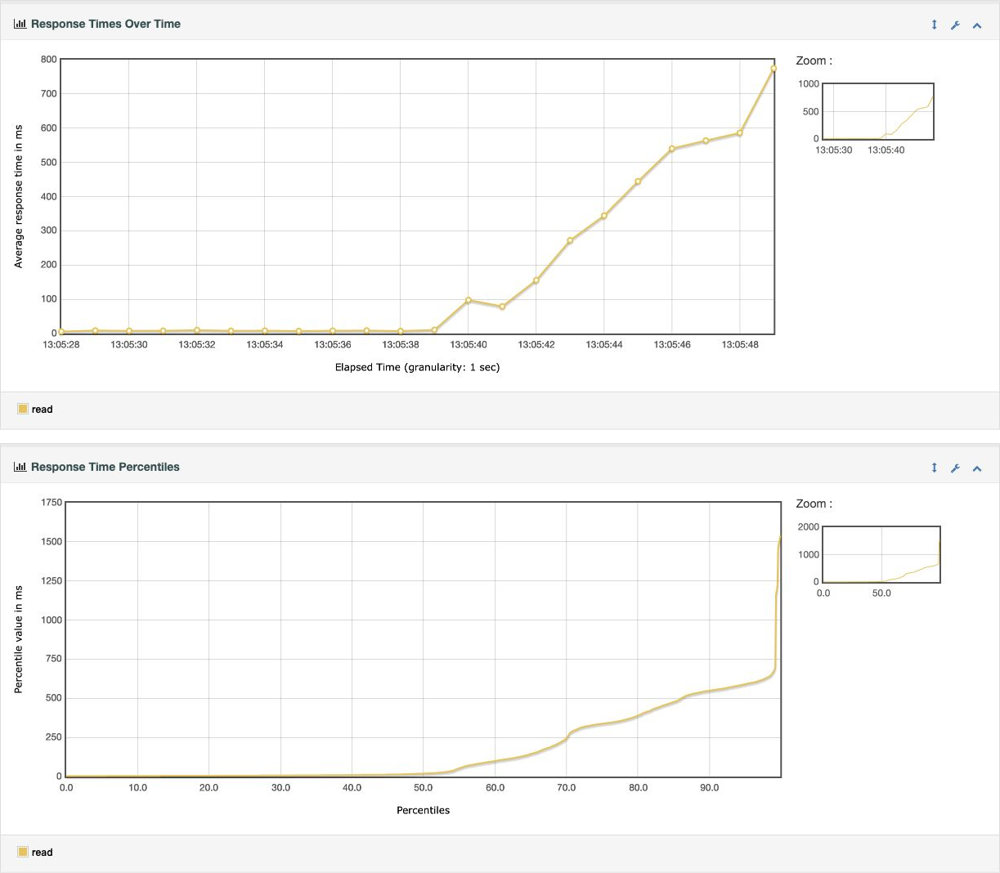

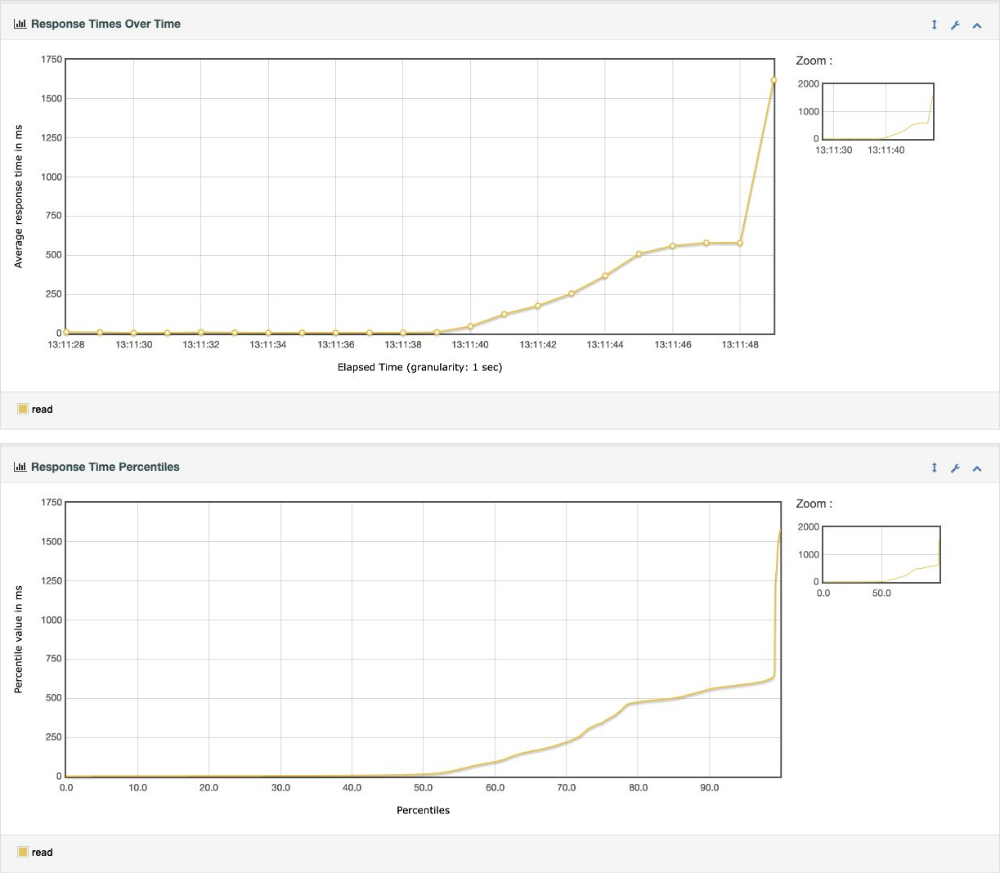

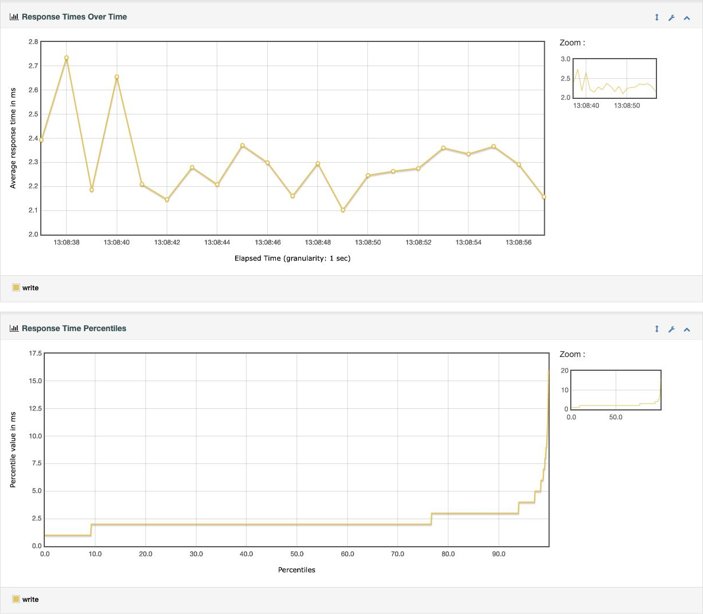

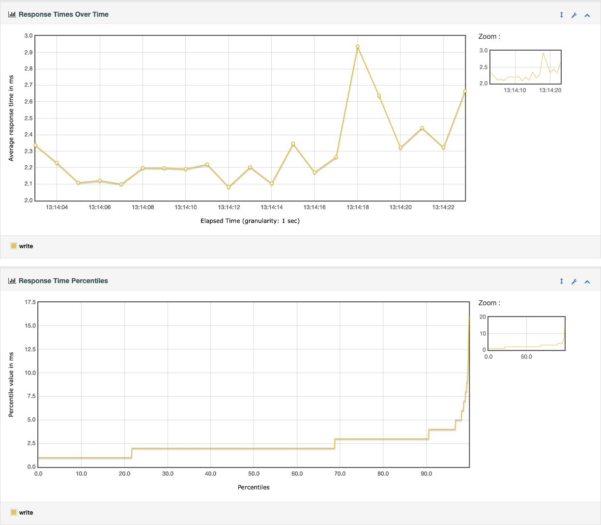

## 5.4　资源与故障证据

平均响应上升后，主机CPU均值用于描述总体忙碌程度，逐核CPU、I/O等待和连接池等待用于定位局部限制。连接池20与40的诊断档均经过应用重启和相同预热，逐次结果列出；短时对照中的差异结合线程与数据库状态解释。每档监控原始序列、诊断快照、应用日志与内核日志按运行名保存。

表11　首次响应转折的资源记录

| 实现/操作 | 应用CPU% | 数据库CPU% | 可用内存MiB | 应用发送MiB/s | TCP重传/s |
| --- | --- | --- | --- | --- | --- |
| MySQL/read | 45.1 | 70.5 | 124.9 | 10.8 | 23.4 |
| MongoDB/read | 37.4 | 74.5 | 209.8 | 10.2 | 45.6 |

查询转折附近，应用发送流量约10 MiB/s，Manager同时出现TCP重传。网络吞吐、线程数增长与内存紧张共同保留为排查证据；主机CPU均值单独不足以确定退化来源。Tomcat工作线程对照用于检查并发处理数量与内存、响应的关系。

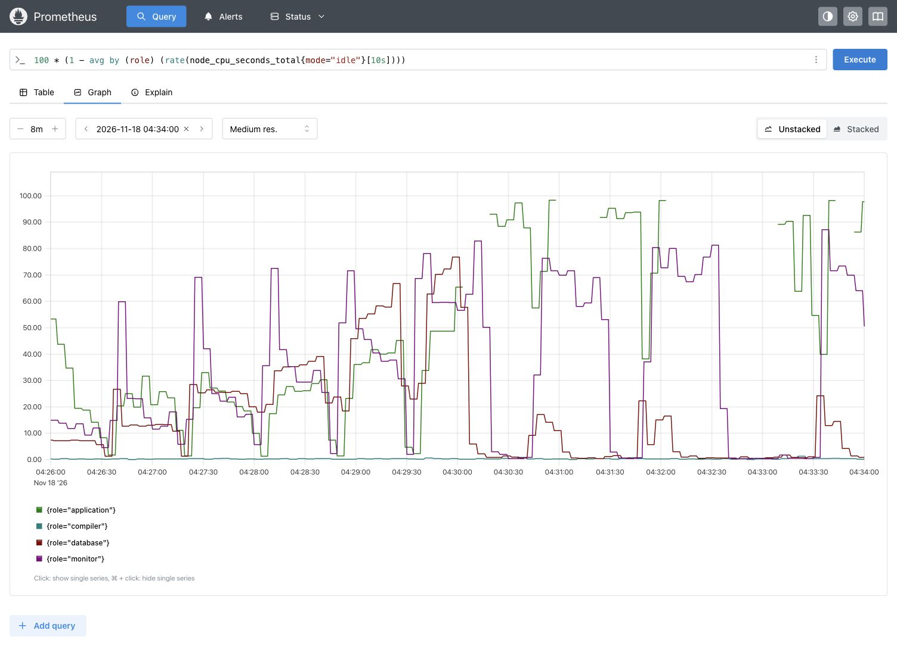

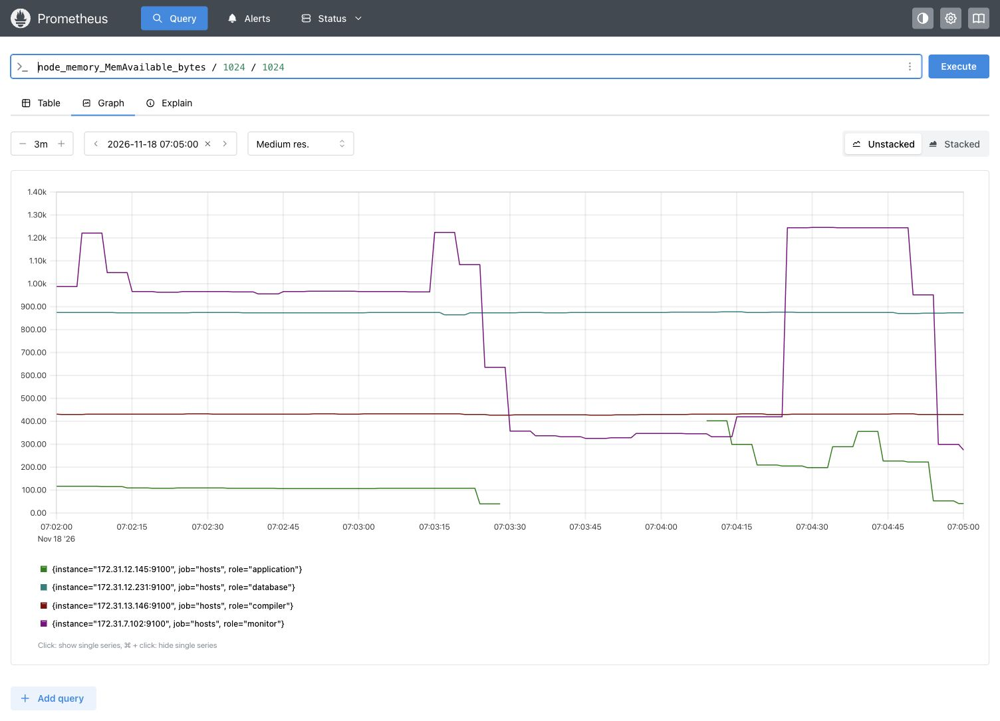

表12　退化运行的故障记录

| 运行 | 日志证据 | 故障时序 | 错误率 |
| --- | --- | --- | --- |
| mysql-read-n37800-r1 | 内核OOM记录 | 窗口后15秒 | 18.0% |
| mysql-read-n31500-r1 | 内核OOM记录、JVM本地内存分配失败 | 窗口后8秒 | 100.0% |
| mysql-read-n37800-r2 | 内核OOM记录、JVM本地内存分配失败 | 窗口后46秒 | 100.0% |
| mysql-read-n37800-r3 | JVM本地内存分配失败 | 见原日志 | 97.1% |
| mongo-read-n31500-r1 | 内核OOM记录 | 窗口后44秒 | 100.0% |
| mongo-read-n37800-r2 | 内核OOM记录、Docker日志采集进程内存失败 | 正式窗口内 | 93.7% |
| mongo-read-n37800-r3 | 内核OOM记录 | 窗口后12秒 | 100.0% |
| mysql-read-n37800-r4 | Docker日志采集进程内存失败 | 采集阶段 | 0.0% |

全部写入运行的数据库记录增长与完整JTL成功响应数一致。

若客户端超时后数据库仍完成提交，记录增长会大于成功响应数；逐次差额与原始请求一并保留。正式统计使用中间20秒，记录增长核对使用整档HTTP请求。JMeter原生吞吐量按样本起止跨度计算，汇总表按固定20秒计算，分母分别记录。

## 5.5　两条链路的共同负载比较

两库共同完成且均匀发送、零错误的查询最高共同档位为25200线程。MySQL平均响应4.22 ms，MongoDB为3.52 ms；实际启动率分别为749.55和744.30次/秒。

表13　查询共同正常负载档位

| 总线程数 | MySQL平均ms | MongoDB平均ms | MySQL错误率 | MongoDB错误率 |
| --- | --- | --- | --- | --- |
| 2800 | 5.15 | 4.06 | 0.0% | 0.0% |
| 5600 | 3.52 | 3.17 | 0.0% | 0.0% |
| 11200 | 3.29 | 2.82 | 0.0% | 0.0% |
| 16800 | 3.33 | 2.96 | 0.0% | 0.0% |
| 25200 | 4.22 | 3.52 | 0.0% | 0.0% |

两库共同完成且均匀发送、零错误的写入最高共同档位为37800线程。MySQL平均响应2.22 ms，MongoDB为2.36 ms；实际启动率分别为1135.30和1142.45次/秒。

表14　写入共同正常负载档位

| 总线程数 | MySQL平均ms | MongoDB平均ms | MySQL错误率 | MongoDB错误率 |
| --- | --- | --- | --- | --- |
| 2800 | 2.83 | 2.62 | 0.0% | 0.0% |
| 5600 | 2.26 | 1.97 | 0.0% | 0.0% |
| 11200 | 1.99 | 1.83 | 0.0% | 0.0% |
| 16800 | 2.03 | 1.92 | 0.0% | 0.0% |
| 25200 | 2.11 | 2.09 | 0.0% | 0.0% |
| 37800 | 2.22 | 2.36 | 0.0% | 0.0% |

读写分别比较相同线程档位与实际启动率。首次响应转折、重启后的复测和参数修正分别列出，数据库性能结论同时结合错误率与应用资源状态。写入在发送端先达到不均匀条件时，容量结论止于最后一个合格档位。

# 6　总结

MySQL查询首次逐级探索中的最高正常负载档为25200个单次请求线程，平均响应时间4.22 ms，实际启动749.55次/秒，错误率0.00%。

MongoDB查询首次逐级探索中的最高正常负载档为25200个单次请求线程，平均响应时间3.52 ms，实际启动744.30次/秒，错误率0.00%。

MySQL写入首次逐级探索中的最高正常负载档为37800个单次请求线程，平均响应时间2.22 ms，实际启动1135.30次/秒，错误率0.00%。

MongoDB写入首次逐级探索中的最高正常负载档为56700个单次请求线程，平均响应时间2.92 ms，实际启动1735.55次/秒，错误率0.00%。

实验以平均响应时间组织负载曲线，逐步增加线程总数，并用完整秒HPS检查发送均匀性。共保留47次运行、617,360次正式样本及111,485次错误。转折附近的细分、连接池对照和资源采样分别保存，结论对应本轮固定数据、查询条件和机器配置。四项RBAC服务已恢复原副本数。

# 参考文献

[1] Apache JMeter. User Manual: Thread Group. https://jmeter.apache.org/usermanual/component_reference.html#Thread_Group.

[2] Apache JMeter. Dashboard Reports. https://jmeter.apache.org/usermanual/generating-dashboard.html.

[3] Spring. Spring Data JPA Reference Documentation. https://docs.spring.io/spring-data/jpa/reference/.

[4] Spring. Spring Data MongoDB Reference Documentation. https://docs.spring.io/spring-data/mongodb/reference/.

[5] Prometheus. Querying basics. https://prometheus.io/docs/prometheus/latest/querying/basics/.
